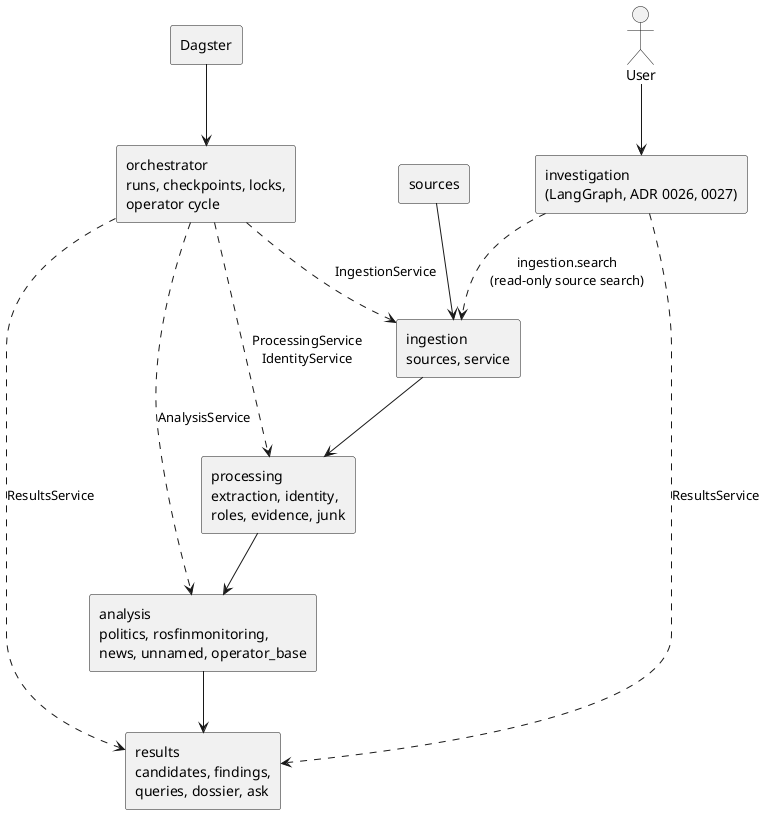

# ADR 0025: A modular monolith of four domain modules and a pipeline orchestrator

## Status

Accepted, 2026-10-12. It carries out `docs/architecture/modularization-plan.md` and
follows [ADR 0024](0024-entity-groups-are-the-canonical-identity.md), which decided
what the code after extraction is built around.

## Context

The code had grown by feature, not by responsibility:

- `monitoring/` held the run lifecycle together with the junk screen, the purge and
  the findings;
- `entities/` held thirty files of one operator cycle: who a person is, what role they
  have, whether the case is political, whether they are on the Rosfinmonitoring list,
  and what a reader is shown;
- `MonitoringService` was given fourteen domain objects and one class of SQL
  (`monitoring/selection.py`) that knew the tables of three modules;
- one command-line file wired the monitoring run and every step of the operator cycle;
- the console read storage classes directly.

Nothing stated which code may call which, so nothing stopped the next feature from
adding one more crossing.

## Decision

One process, one PostgreSQL database, plain Python calls. No network protocol between
the modules, no broker, no new scheduler.

| Module | Owns | Public API |
|---|---|---|
| `ingestion` | source adapters, discovery, fetch, parse, storing documents; which documents are stored; which documents of a run are kept by publication date | `ingestion.service.IngestionService` |
| `processing` | extraction; identity (entity groups, ADR 0024); roles and officials; publication evidence, digests, sentences; the junk screen and purge; a person's corrections of all of these | `processing.service.ProcessingService`, `processing.identity.service.IdentityService` |
| `analysis` | the verdicts: political or not, on the Rosfinmonitoring list or not, the latest of a case, who an unnamed figurant may be; the list itself and the operator's reference lists (`airtable/`) | `analysis.service.AnalysisService` |
| `results` | what a reader is shown: candidates, findings, rows folded into cases, a person's dossier, «Спросить» | `results.service.ResultsService` |
| `orchestrator` | which stage runs when: the run lifecycle, checkpoints, advisory locks, heartbeat, failed items, stage metrics, the operator cycle and its operations, the Dagster definitions | `orchestrator.service.MonitoringService`, `orchestrator.cycle.OperatorCycle`, `orchestrator.runs.MonitoringRuns` |
| `investigation` | one question — about a named person, or about whom a publication leaves unnamed — answered from what is stored and from configured sources outside (ADR 0026, 0027) | `investigation.service.InvestigationService` |

Rules, each held by `tests/test_module_boundaries.py`:

1. **Layering.** An earlier stage never imports a later one. A domain module never
   imports an orchestrator, tooling (`evaluation/`) or an entry point. Shared code
   (`db`, `monitor_core`, `llm`, `observability`) imports no domain module.
2. **The orchestrator coordinates.** It imports of the domain only the public APIs
   above and the registry of sources. It holds no domain query: each module answers
   "what is pending" itself (`processing.extraction.pending`,
   `persons.resolution.pending`, `analysis.pending`, `ingestion.stored`).
3. **Dagster schedules.** Its assets import only `orchestrator`; each calls one stage
   of `MonitoringService`.
4. **Internals are closed.** The console, the API and the pipeline commands import no
   module listed as internal: the rules and the rebuild of identity, the extraction
   pipeline and its storage, the pending queries, the storage and matching classes.
5. **Two orchestrators, never mixed.** `orchestrator` and `investigation` do not import
   each other.

The allowlist of tolerated violations is empty, and a test keeps it empty. Relative
imports are resolved to the module they name before a rule is applied, and one that
climbs above its top package is an error. A package imported whole is checked as the
package, so it cannot stand in for the one public module inside it.

The list of internals is a list, not everything a module has: person resolution's
services and the junk screen's implementation are not on it.

### What was kept as it was

- **Semantics of a run.** Persistent state, checkpoints, advisory locks, the heartbeat
  fence, per-item failure records and stage metrics moved with their code and their
  tests. A storage failure still stops the ingestion stage; a document that cannot be
  read is still one failed item. The characterization tests of the run were not edited
  to pass.
- **Logger names.** `monitoring`, `monitoring.embedder`, `entities` and
  `operator_console` stay the names the log is filtered by, though the packages are
  renamed.
- **The model's role.** DeepSeek names a group the rules made (nominative, gender,
  person or not). It is behind `IdentityService` and decides no identity.
- **ER v2.** `persons/` is not moved and not extended. The monitoring run reaches it
  through one door, `persons.resolution.stage.PersonResolutionStage`; identity and the
  investigation never import it.
- **The schema.** No migration.

## Consequences

- A step of the operator cycle is one call of one module's API; the order of the steps
  is `orchestrator/cycle.py` and nothing else.
- The facades are thin where the code behind them was already one service per unit of
  work. They are the stable names; what is behind them can change without its callers.
- `airtable/` is classified with `analysis`: it holds the operator's reference lists
  and keys them with the extraction normalizer, so it was never shared infrastructure.

### The refactor is closed

As of 2026-10-12 (branch `feat/complete-investigation-runtime`) the modularization is a
finished project. Each item this ADR first listed as left has one status; what comes
after is a feature, a bug, a performance or a maintenance task, not a further step of
this refactor.

| Item | Status | Where it stands |
|---|---|---|
| The console reads vocabularies and read models from module files | **done** | They are the modules' public read contracts, named in `CONSOLE_READ_MODELS` (`tests/test_module_boundaries.py`): a page that reads any other module file fails, and a listed one nobody reads fails too. One service per page is still not built, by design. |
| The older single-module commands build their parts themselves (`ingest-*`, `extract-*`, `resolve-people`, `classify-persecution`, `match-rosfinmonitoring`, `list-candidates`, `cli_batches.py`) | **done** (rule) / **intentional legacy** (ER v2) | They are maintenance tools of one module each, held to it by `MODULE_TOOLS`. `resolve-people`, `classify-persecution`, `match-rosfinmonitoring`, `list-candidates` belong to the frozen ER v2 path and say «[legacy: ER v2]» in their help. |
| `analysis/unnamed/figurants.py` is not split | **done** | Reading the sentences is `processing/evidence/unnamed.py`; matching to the list is `analysis/unnamed/matching.py`; `figurants.py` keeps the finder, the screening and a person's decisions; `AnalysisService.find_unnamed` stays the one workflow. |
| Two classifiers and two matchers in `analysis` (entity groups; persons) | **intentional legacy** | The person pair is the monitoring run's and goes with ER v2 (ADR 0024). |
| `llm/cli_reviewer.py`, `llm/entity_reviewer.py` implement a contract of `persons` | **intentional legacy** | ER v2's AI review; classified with `processing` by `MODULE_OF`, and goes with ER v2. |
| Tests stay in directories named after the old packages | **intentional legacy** | Locations only; no rule depends on them, and moving them would cost history for nothing the boundary tests do not already hold. |
| No semantic retrieval, no source outside the database (ADR 0026) | **done** | ADR 0027: scenarios, a retriever registry, lexical and optional dense retrieval fused by rank, a read-only search of configured Telegram channels, stored and resumable runs. |

**ER v2 callers**, traced 2026-10-12: `orchestrator/service.py`
(`PersonResolutionStage`: the automated monitoring run); `application.py` and
`settings.py` (wiring, configuration); `analysis/pending.py` and
`processing/junk/purge.py` (the run's pending persons; the purge's person records);
`web/routers/reviews.py` (the person review endpoints); `cli/persons.py`,
`cli/persecution.py`, `cli/areas.py` (the legacy commands); `evaluation/*` (tooling).
The automated monitoring still needs it, so it stays; removing it is the separate
decision of ADR 0024. **No investigation code depends on it**
(`test_an_investigation_never_depends_on_er_v2`).

**Two identity universes.** The person path's pages (`/persons`, `/candidates`, the
findings on `/monitoring`) are reachable by address only, in the legacy menu and the new
one alike; every page of the menu, the dossier and the investigation are entity groups.
A reader following the console never meets a Person, so nothing was rerouted.
