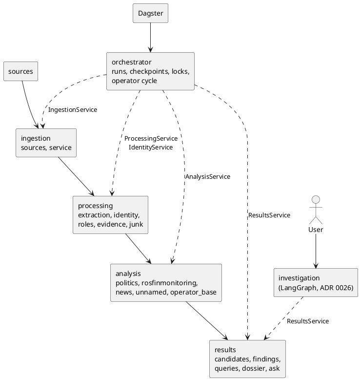

# ADR 0025: A modular monolith of four domain modules and a pipeline orchestrator

## Status

Accepted, 2026-10-12. It carries out `docs/architecture/modularization-plan.md` and
follows [ADR 0024](0024-entity-groups-are-the-canonical-identity.md), which decided
what the code after extraction is built around.

## Context

The code had grown by feature, not by responsibility:

- `monitoring/` held the run lifecycle together with the junk screen, the purge and
  the findings;
- `entities/` held thirty files of one operator cycle: who a person is, what role they
  have, whether the case is political, whether they are on the Rosfinmonitoring list,
  and what a reader is shown;
- `MonitoringService` was given fourteen domain objects and one class of SQL
  (`monitoring/selection.py`) that knew the tables of three modules;
- one command-line file wired the monitoring run and every step of the operator cycle;
- the console read storage classes directly.

Nothing stated which code may call which, so nothing stopped the next feature from
adding one more crossing.

## Decision

One process, one PostgreSQL database, plain Python calls. No network protocol between
the modules, no broker, no new scheduler.

| Module | Owns | Public API |
|---|---|---|
| `ingestion` | source adapters, discovery, fetch, parse, storing documents; which documents are stored; which documents of a run are kept by publication date | `ingestion.service.IngestionService` |
| `processing` | extraction; identity (entity groups, ADR 0024); roles and officials; publication evidence, digests, sentences; the junk screen and purge; a person's corrections of all of these | `processing.service.ProcessingService`, `processing.identity.service.IdentityService` |
| `analysis` | the verdicts: political or not, on the Rosfinmonitoring list or not, the latest of a case, who an unnamed figurant may be; the list itself and the operator's reference lists (`airtable/`) | `analysis.service.AnalysisService` |
| `results` | what a reader is shown: candidates, findings, rows folded into cases, a person's dossier, «Спросить» | `results.service.ResultsService` |
| `orchestrator` | which stage runs when: the run lifecycle, checkpoints, advisory locks, heartbeat, failed items, stage metrics, the operator cycle and its operations, the Dagster definitions | `orchestrator.service.MonitoringService`, `orchestrator.cycle.OperatorCycle`, `orchestrator.runs.MonitoringRuns` |
| `investigation` | one question about a person, answered from what is stored (ADR 0026) | `investigation.service.InvestigationService` |

Rules, each held by `tests/test_module_boundaries.py`:

1. **Layering.** An earlier stage never imports a later one. A domain module never
   imports an orchestrator, tooling (`evaluation/`) or an entry point. Shared code
   (`db`, `monitor_core`, `llm`, `observability`) imports no domain module.
2. **The orchestrator coordinates.** It imports of the domain only the public APIs
   above and the registry of sources. It holds no domain query: each module answers
   "what is pending" itself (`processing.extraction.pending`,
   `persons.resolution.pending`, `analysis.pending`, `ingestion.stored`).
3. **Dagster schedules.** Its assets import only `orchestrator`; each calls one stage
   of `MonitoringService`.
4. **Internals are closed.** The console, the API and the pipeline commands import no
   module listed as internal: the rules and the rebuild of identity, the extraction
   pipeline and its storage, the pending queries, the storage and matching classes.
5. **Two orchestrators, never mixed.** `orchestrator` and `investigation` do not import
   each other.

The allowlist of tolerated violations is empty, and a test keeps it empty. Relative
imports are resolved to the module they name before a rule is applied.

The list of internals is a list, not everything a module has: person resolution's
services and the junk screen's implementation are not on it.

### What was kept as it was

- **Semantics of a run.** Persistent state, checkpoints, advisory locks, the heartbeat
  fence, per-item failure records and stage metrics moved with their code and their
  tests. A storage failure still stops the ingestion stage; a document that cannot be
  read is still one failed item. The characterization tests of the run were not edited
  to pass.
- **Logger names.** `monitoring`, `monitoring.embedder`, `entities` and
  `operator_console` stay the names the log is filtered by, though the packages are
  renamed.
- **The model's role.** DeepSeek names a group the rules made (nominative, gender,
  person or not). It is behind `IdentityService` and decides no identity.
- **ER v2.** `persons/` is not moved and not extended. The monitoring run reaches it
  through one door, `persons.resolution.stage.PersonResolutionStage`; identity and the
  investigation never import it.
- **The schema.** No migration.

## Consequences

- A step of the operator cycle is one call of one module's API; the order of the steps
  is `orchestrator/cycle.py` and nothing else.
- The facades are thin where the code behind them was already one service per unit of
  work. They are the stable names; what is behind them can change without its callers.
- `airtable/` is classified with `analysis`: it holds the operator's reference lists
  and keys them with the extraction normalizer, so it was never shared infrastructure.

### What is left

- **The console still reads vocabularies and read models from module files.** The
  pages import constants (`POLITICAL`, `FULL`, `KIND_LABELS`), readers
  (`rf_entry`, `known_base`, `jurisdiction`) and a person's decisions on roles,
  politics, unnamed figurants and junk holds from the files that define them. None is
  on the internal list, and identity, runs, findings and the list's snapshot go through
  services. One service per page was not built: it would be a second copy of each
  file's names.
- **The older single-module commands build their parts themselves**: `ingest-*`,
  `extract-*`, `resolve-people`, `classify-persecution`, `match-rosfinmonitoring`,
  `list-candidates` (`cli/ingestion.py`, `cli/extraction.py`, `cli/persons.py`,
  `cli/persecution.py`, `cli/rosfinmonitoring.py`, `cli/candidates.py`,
  `cli_batches.py`). They belong to the person path and are not closed to internals.
- **`analysis/unnamed/figurants.py` is not split.** Reading the sentences that describe
  an unnamed person is processing; matching them to the list is analysis. The file
  does both and lives in `analysis`.
- **Two classifiers and two matchers stay in `analysis`**: over entity groups
  (`politics/`, `rosfinmonitoring/rf_check.py`) and over persons (`persecution/`,
  `rosfinmonitoring/matcher.py`). The second pair is the monitoring run's and goes when
  ER v2 goes, which is a separate decision (ADR 0024).
- **`llm/cli_reviewer.py` and `llm/entity_reviewer.py`** implement a contract of
  `persons` and still live in `llm/`.
- Tests stay in the directories named after the old packages (`tests/entities/`,
  `tests/monitoring/`, …).
