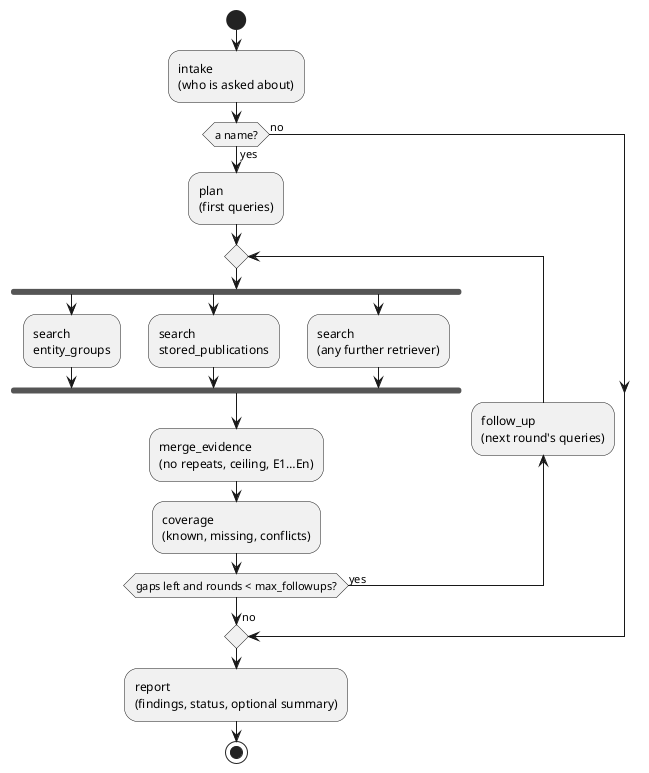

# ADR 0026: An investigation workflow on LangGraph, over the module APIs

## Status

Accepted, 2026-10-12; extended by [ADR 0027](0027-investigation-runtime-scenarios-and-retrieval.md)
the same day (scenarios, a retriever registry, lexical, dense and outside retrieval,
stored runs). Where they differ, 0027 is what the code does. A new layer. It takes the contracts of
[ADR 0008](0008-research-domain-and-research-service.md)–[0010](0010-research-report-review-routing.md)
that still hold (facts and provenance are not created by a model; a failure is not an
empty result; review required is a status) and none of their code: that layer was
removed on 2026-09-27 and was built on canonical persons, which
[ADR 0024](0024-entity-groups-are-the-canonical-identity.md) no longer builds on.

## Context

The operator cycle answers "who is persecuted" for everybody at once. A reader also
asks about one person: what is known, on what grounds, and what is not known. Until
now that was the dossier page, read by eye.

Two things are called an orchestrator and must not be confused:

| | Pipeline orchestrator (ADR 0025) | Investigation |
|---|---|---|
| Started by | a schedule, the operator cycle | a question |
| Does | discover, ingest, extract, entities, analysis | plan, search, weigh, follow up, report |
| Writes | the whole database | nothing |
| Runs on | Dagster and `orchestrator/` | LangGraph and `investigation/` |

## Decision

`src/investigation/` is a LangGraph state graph with explicit nodes. It is not an
agent: no node chooses the next node, and no model chooses a tool.

**State.** `InvestigationState` holds only models of `investigation.models` and lists
of them, so it is serializable as it stands. `found`, `usage` and `warnings` have
reducers: the branches of a round write them in parallel. No checkpointer is attached:
a run is short and synchronous to its caller. No table was added.

**Identity is the entity group.** A person is looked up by name among the entity
groups. One group answering is the subject; several are candidates and the status is
`review_required`; none is `partial` with the person named as not found. This is
settled on everything the search returned, before the ceiling on evidence is applied. ER v2 is not
imported, and a boundary test holds that.

**A fact needs evidence.** `Finding.evidence` cannot be empty. Findings are built by
code from what the pipeline decided (role, charges, political or not, the list, the
latest news), each citing the `EvidenceItem`s that state it. A value a step left as
«unclear» is missing, not a fact. A quote found while looking for a missing fact is a
*lead*: it is evidence, it is named in the warnings, and it becomes no finding. One
quote may be a lead for several facts.

**Coverage is rules.** `services/coverage.py` says what is known, what is missing, what
contradicts itself (several values of one fact; a list match by given name and surname
alone), and which words to look for next. The same evidence always gives the same
assessment.

**The loop is bounded.** `Limits.max_followups` (default 2,
`INVESTIGATION_MAX_FOLLOWUPS`) rounds, then the report says the search was not
finished. A run may lower the ceiling, never raise it. LangGraph's recursion limit is
set from it as a second stop.

**Retrieval is an interface.** `InvestigationRetriever` has a name, says whether it is
local, and searches. Two ship, both over `ResultsService`:

| Retriever | Reads |
|---|---|
| `entity_groups` | the person's group, what the pipeline decided of it, the places publications name them; and, in a follow-up, the person's own publications by word |
| `stored_publications` | stored publications whose text holds the name, whether or not a group was made of them |

A site, a channel or a vector index is one more object in the list given to
`InvestigationService`. A person a later round finds under another key makes the name
ambiguous; it never replaces the subject. One place in a text tied to two people is
kept as two pieces of evidence. `--local-only` keeps the non-local ones out. A retriever that
fails costs its evidence and a warning.

**The graph runs no SQL.** It imports `results.service` and nothing else of the domain;
the queries are `results/dossier.py`. Two boundary tests hold that.

**A model is optional, behind a port, and never a source.** `InvestigationModel` is
one method. With OpenRouter configured it is asked at most
`INVESTIGATION_MAX_LLM_CALLS` (default 2) times:

- at intake, to read the name out of the question. Each word of the name it returns
  must be a word of the question, the same or up to an ending of three letters, or the
  rules read the name instead. That stops another person's name; it does not stop two
  surnames that differ only in such an ending («Петров», «Петрова»), and it refuses a
  word whose stem changes («Лев», «Льва»);
- at the report, to word `model_summary`. Each sentence must cite evidence that
  exists; a sentence that cites none is dropped and said in the warnings.

**The summary is not checked for support.** That a cited item exists does not show it
says what the sentence says: a model can put «E1» under anything, by mistake or because
a publication told it to. So `model_summary` is a separate field, never a source of a
finding and never an input to `status`; every result that carries one carries the
warning that it is unchecked, and the command prints it under that heading. The facts
of a result are `findings`, which no model writes.

Without a model the same graph runs on rules alone.

**Text of a publication is data.** A prompt has three parts kept apart: the
instructions (`prompts/*.md`), the question in its block, the evidence in its block. A
closing tag inside a quote is defused so a quote cannot end its block. Beyond the
prompt, the structure holds: follow-up queries come from the coverage rules, never from
found text, so a quote cannot add a query or a source. A quote found as a lead does
decide whether its fact is looked up again, which is the loop working as designed. A
model that obeys an instruction in a quote can still write it into `model_summary`
under an existing reference: see above for why that field is labelled unchecked.

**Budget is counted.** `Usage` in the state: model calls, input and output tokens,
cost, searches, follow-up rounds. Hard limits: model calls, rounds, evidence items
(`INVESTIGATION_MAX_EVIDENCE_ITEMS`, default 40; facts are kept before quotes, so a
ceiling below the number of facts cuts facts too, and the result says how many items
were cut). A call that was paid for and then refused as unusable (a cut answer) is
counted as a call; its tokens and cost are not.

**Status.** `completed`, `partial` (something is missing), `clarification_required`
(no name in the question), `review_required` (several people or a contradiction),
`failed` (an exception inside; never an empty success). The status is computed from the
subject, the missing facts and the conflicts alone: the same evidence gives the same
status with a model and without one, whatever the model wrote.

**Entry points.** `main.py investigate "…" [--json] [--max-followups N] [--local-only |
--no-web]` and `POST /api/v1/investigation`. No streaming.

## Consequences

- An answer about one person carries its grounds and its gaps in one typed value.
- The first use case is one person. A question that names nobody is
  `clarification_required`. The rules take the longest run of capitalized words for a
  name, so a question about «Московский Городской Суд» is searched as a person and
  comes back not found.
- **No semantic retrieval.** The vector search of
  [ADR 0011](0011-semantic-hybrid-entity-retrieval.md) was removed with its code, and
  Qdrant is not used by this repository now. Name lookup is by word beginnings. A
  semantic retriever would be one more `InvestigationRetriever`.
- **No source outside the database is asked.** The source adapters of `ingestion`
  discover and fetch whole feeds; none searches by a person's name. Until one does,
  `--local-only` and `--no-web` change nothing.
- **Namesakes.** Two people of one name are one entity group when nothing tells them
  apart (ADR 0024); an investigation then reports them as one, with no warning. When
  they are two groups, it says so and stops.
- **A missing list match is not "not on the list".** The database does not tell an
  unchecked person from an unmatched one, so the result says the fact is missing.
- The limits are read from the process environment. `compose.yaml` does not pass
  `INVESTIGATION_*` to the container, so the API there runs on the defaults.
- A live run on synthetic data, 2026-10-12: two calls, 605 input and 98 output tokens,
  $0.00016. The model read a name written in lower case, which the rules alone do not.
