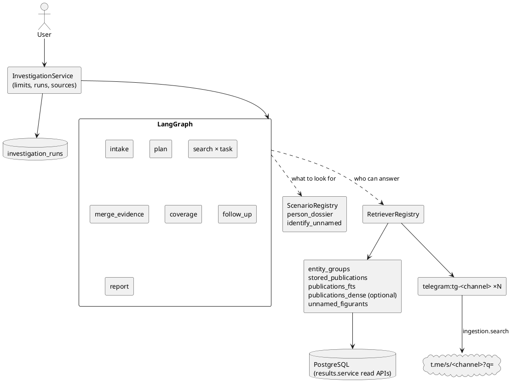
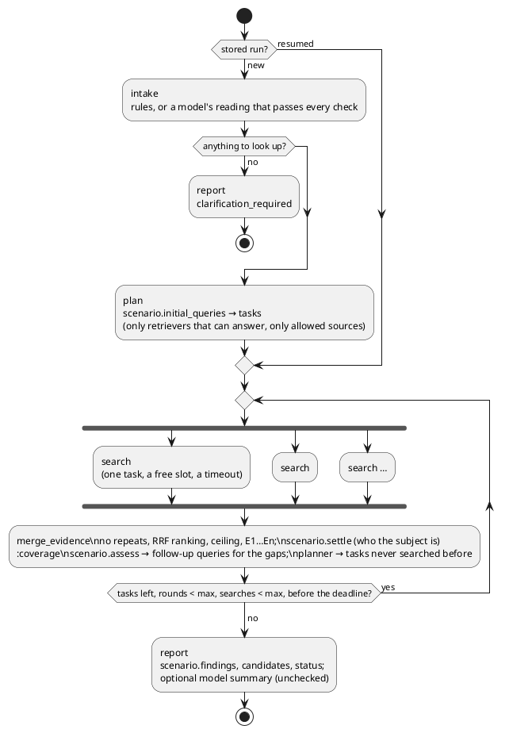

# ADR 0027: The investigation runtime — scenarios, a retriever registry, outside sources

## Status

Accepted, 2026-10-12. Extends [ADR 0026](0026-investigation-workflow-on-langgraph.md):
its contracts hold (a fact needs evidence, a model is never a source, the loop is
bounded, status comes from facts alone). What it called the first use case is now one
scenario of two, and what it listed as not done — semantic retrieval, a source outside
the database, a filter of sources that changes anything — is done here.

## Context

ADR 0026 built one graph for one question: what the database holds of one named person.
Every fact of that use case lived in the graph's nodes. Retrievers had a name and a
`local` flag; every query went to every retriever; `--local-only` changed nothing,
because no retriever was not local. A second kind of question — who is the person a
publication leaves unnamed — would have been a second graph or a branch in each node.

## Decision

### The graph runs a lifecycle, a scenario says what to look for

The nodes know no fact. `InvestigationScenario` (`scenarios/base.py`) is: the facts it
can report, its intent by rules, its subject, its first queries, how it settles who the
subject is, how it assesses coverage (and the next round's queries, for the gaps only),
its findings, its candidates, its status. A third scenario is one more object in the
registry; `tests/investigation/test_investigation_runtime.py` plugs in one the graph has
never seen.

| Scenario | Question | Subject | Result |
|---|---|---|---|
| `person_dossier` | «Что известно про X?», «Есть ли X в перечне?», «За что преследуют X?» | the entity group answering the name | the pipeline's facts with their evidence; leads for missing facts |
| `identify_unnamed` | «Установи фигуранта публикации 12345» | the publication | the clues it gives; list entries and people who fit, each with signals and a score |

### Intent and plan are typed

`InvestigationIntent` (scenario, subject name, publication id, requested facts, source
constraints) is read by rules. A model may read it into the same schema; its reading is
taken whole or not at all: the scenario must be known, the name must stand in the
question, the id must stand in the question, every requested fact must be the
scenario's, and no field outside the schema (a tool, a URL, a source) may appear. The
sources a run keeps to come from the request, never from the model.

`InvestigationPlan` holds the scenario, the subject, the requirements and the
`SearchTask`s (query, retriever, purpose, round, priority, fingerprint). It holds no text
of a publication and is part of the result and of the stored run.

### Retrievers say what they can do

| retriever | local / network | backend | answers (kinds) | facts it can bring | score |
|---|---|---|---|---|---|
| `entity_groups` | local | entity groups, their verdicts, mentions, `entity_profile` | person, publication_terms | role, charges, politics, rf_list, latest_news | exact / declined name |
| `stored_publications` | local | `LIKE ALL` over `parsed_articles.text` | person | identity | source order |
| `publications_fts` | local | PostgreSQL FTS, `search_vector` (GIN) | keywords | role, charges, latest_news, corroboration | `ts_rank_cd` |
| `publications_dense` | local, optional | pgvector over `publication_vectors` | keywords | same | cosine |
| `unnamed_figurants` | local | `unnamed_figurants`, the list, mentions | unnamed, publication_people | clues, candidates | — |
| `telegram:tg-<channel>` | network | the channel's web-preview search | keywords | role, charges, latest_news, corroboration | source order |

`RetrieverCapabilities` is the contract; the planner sends a query only to a retriever
whose kinds include the query's and whose facts include what it looks for.
`RetrieverRegistry` is built by the composition root (`application.py`); nothing a run
reads adds to it. `--local-only` / `--no-web` keep the network ones out; `--source NAME`
(`allowed_sources`) keeps to a source (`local`, `telegram`) or one retriever; an
unknown source is a validation error (CLI exit, HTTP 422), never ignored.

### Lexical retrieval: PostgreSQL FTS

`results.search.search_publications` asks `parsed_articles.search_vector`
(`to_tsvector('russian', text)`, GIN index, already there). The name is matched by its
stems (`plainto_tsquery`, every word; order free; declined forms meet in the stemmer),
the terms of a missing fact by the beginnings of their stems (`'арест':*` finds
«арестовал», which the stemmer cuts differently), at least one of them. Ranked by
`ts_rank_cd` (normalized), optionally within a date window. No Elasticsearch.

### Semantic retrieval: optional, pgvector, fused by rank

Of the old semantic subsystem (ADR 0011, 0018) the schema and the pgvector extension
were left; no code, no vectors. Qdrant is not brought back. `publication_vectors` holds
windows (1 200 characters, stride 1 000) of each publication's text, embedded with the
title before them as passages (`intfloat/multilingual-e5-base`: «passage:» /
«query:», `normalize_embeddings=True`; configurable by `INVESTIGATION_DENSE_MODEL`).
`index-publications` builds it on demand through `ProcessingService`; an unchanged
article is skipped. The dense retriever is registered only when the model is configured
and the optional `semantic` group is installed; deployment images do not install it.

An article ranks by its nearest window, found before any limit: a limit on windows
first would let one long text take them all.

Hybrid retrieval is the registry: `publications_fts` and `publications_dense` answer
the same keyword query, and `merge_evidence` fuses every retriever's list by Reciprocal
Rank Fusion (k = 60) on the document. A `ts_rank` and a cosine are never added. No
cross-encoder: nothing measured asks for one yet.

### Outside sources: a read-only search per configured source

Discovery («the newest items of a feed») and search («material about X») are different
capabilities. `ingestion.search` is the second, separate from the source adapters: a
`SourceSearch` per configured source, read-only, storing nothing.

One ships: a public Telegram channel's own search, through its web preview
(`https://t.me/s/<channel>?q=<words>`): no account, no credentials. The channels are
those of `ingestion/sources/telegram/channels.csv` only, chosen by
`INVESTIGATION_TELEGRAM_CHANNELS` (default four: ОВД-Инфо LIVE, Медиазона, «Поддержка
политзеков. Мемориал», Политзек-Инфо; `none` for none). A post is kept only if it
names every word of the person's name. An answer that is not a page (JSON, plain text)
is a failed search, not an empty one. Generic web search would need a commercial API
the project does not have; none was added, and nothing scrapes a search engine.

OVD-Info's and Memorial's sites have no search the code can use (404 on `/search`,
403 on the WordPress API): their stored publications are searched locally instead.

**Found outside stays outside.** A post is the evidence of the investigation that found
it. Nothing is stored, extracted or grouped; promoting it to the pipeline would be a
separate, explicit action.

### No open-URL tool, no SSRF

A search's address is built from its configured channel alone: scheme `https`, host
`t.me`, path `/s/<username>` (a username by Telegram's own rule); the words travel only
as `q`. There is no tool that fetches a URL a user, a model or a text supplies, so
`localhost`, private ranges, metadata endpoints and `file://` are unreachable by
construction; `tests/sources/test_source_search.py` sends such strings as words and
checks the address.

### Bounded, timed, retried

- `INVESTIGATION_MAX_PARALLEL_SEARCHES` (default 4): a semaphore per run around every
  search;
- `INVESTIGATION_MAX_SEARCHES` (40), `INVESTIGATION_MAX_FOLLOWUPS` (2),
  `INVESTIGATION_MAX_EVIDENCE_ITEMS` (40), `INVESTIGATION_MAX_LLM_CALLS` (2);
- `INVESTIGATION_SEARCH_TIMEOUT_SECONDS` (20) per search, `INVESTIGATION_TIMEOUT_SECONDS`
  (120) per run: nodes stop starting work at the deadline; the service stops the graph
  10 s after it.

A local search works in a thread, and a thread cannot be stopped: at its timeout the
wait ends, the work does not. Its slot therefore stays taken until the work ends, and
the database cuts its statement at the search timeout (`db.database.with_statement_timeout`:
`SET LOCAL statement_timeout` in every transaction of the retrievers' sessions). An
embedding in progress cannot be cut; it keeps its slot until it is done.

The model's summary is the one optional step: it is not begun after the deadline and
does not outlive it. The same evidence gives the same status and findings whether the
model answered, timed out or was never asked.

A request lowers a limit, never raises one (`Limits.narrowed`). A search that fails or
times out costs its evidence and a warning; a run whose every search failed is `partial`
with nothing invented. Retries are network-only and bounded (2 attempts): timeouts,
dropped connections, 429, 5xx (`monitor_core.retry.transient_http_error`), never 4xx or
a bad answer.

### Evidence, ranking, follow-up

Every `EvidenceItem` carries its provenance: `ref` (the evidence id), `retriever`,
`source_type`, `source_name`, `external_id`, `article_id`, `url`, `published_at`,
`title`, `text`, span, `entity_key`, `query`, `round`, `score` and `score_type`,
`retrieved_at`. Repeats are found by the place in an article, the post's id at its
source, a canonical URL, a text fingerprint; two quotes of one document for different
facts or different people both stay. Ranking: facts before quotes, the person's quotes
before those that only hold the name, RRF over the lists that found a document, the
newest last.

The follow-up searches only what is missing and only where it can be found: after the
first round, a dossier missing «charges» and «rf_list» asks for charges alone (the list
has no wording a text could supply), of `entity_groups` (the person's own
publications), `publications_fts` and the channels. Every search made is fingerprinted
(retriever + query); the same search is never made twice, and a round with nothing new
to search ends the run (`partial`, «no way left to search»), unless the gap has a lead.

### Conflicts and namesakes

`Conflict` holds the fact, the description, the refs of both sides and whether it is
critical (a critical one is `review_required`). Generic: two values of one fact; a list
match by given name and surname alone. A group that may hold two people
(`possible_mixed_identity_group`, from `entity_profile`): two patronymics in the forms
the news wrote, two birth dates among the list entries the name matched (critical);
two regions of the registry cards (a sign, not critical). The group is never split by
an investigation. A person found only by a text outside never becomes the subject; a
name several groups answer is `review_required` with the candidates.

### The unnamed figurant

Round 0: the figurant's clues (what the pipeline read: age, sex, place, initial,
articles, event) and the list entries they fit (`analysis.unnamed.matching`). Round 1:
the best three entries' surnames with the place, and the place with the articles in the
45 days around the news (FTS, the channels). Round 2: the people of the database those
publications name. Each candidate's score is a sum of named signals (age exact +2, near
+1, sex +1, initial +2, birthplace +3, a person's confirmation +10, removed from the list
−0.5, named with the place in a text +3, a shared article +2, a publication of the place
+2, the same days +1). A person named in the very publication is not the unnamed one — in whichever
publication the name is met again, and as a list entry of the same name: the
publication's people are asked for in the first round. The figurants of a publication
are counted over everything found, not over what the ceiling left to show: a second one
that was cut still forbids a likeliest candidate.
A candidate ≥ 7 and 3 ahead of the next is reported as the likeliest, with the warning
that it is a ranking, not an identity; anything less is `review_required`; no candidate
is `partial`.

### Runs are stored and resumed

`investigation_runs` (migration `l2m3n4o5p6q7`): run id, question, status, scenario,
round, request, usage, progress, result, failure, times. Saved when planned, as each
search ends (its fingerprint, what it found, its usage — one atomic change of the
stored progress, since the searches of a round end in parallel), after each coverage
(the whole resumable state) and when it ends.

`--resume RUN_ID` first makes the searches of the first round that were never made — a
run stopped right after its plan, or between two searches — and then goes on from what
was found; later rounds are planned again from what is missing. A search already made
is not made again; its evidence — local or from a channel — is read from the store. A
finished run returns its result.

One process works on a run at a time. It claims the run before it reads its progress: a
PostgreSQL advisory lock keyed by the run id, held by a connection of its own for the
run's time; a second process is refused (`RunBusyError`), and a process that dies lets
go with its connection. Progress and the result are written only to a run still
`running`, so what a late branch of a stopped graph writes cannot replace a result.

A resumed run is held to the lower of its stored limits, the service's limits of now
and what the call asks (`Limits.within`, `narrowed`). It stays local if it was or is
asked to be; its sources can only be narrowed; an unknown source, or one outside the
run's own, is refused. `--scenario` cannot change a stored run. Not stored: prompts, a model's raw answer, keys, whole
publications. LangGraph's Postgres checkpointer was not used: it brings its own tables
outside the migrations, and a run's state is small enough to keep as one JSON. No Redis.

`GET /api/v1/investigation/{run_id}` and `investigate --run-id ID` read a stored run.

### The model's place

Allowed: reading the question into the intent; wording the summary. Not allowed, and
held by the structure rather than the prompt: naming a person the question does not
name, choosing a source or a tool, adding a fact, a URL or a source. `model_summary` stays
unchecked and labelled so; findings come from code alone, and the same evidence gives
the same status with a model and without.

### Observability

`investigation.telemetry`: `event=investigation_{started, plan_built, search_started,
search_completed, search_failed, coverage_assessed, followup_started, completed,
failed}` with run id, scenario, retriever, round, durations, counts; a query is logged
as a hash and a length, never its words. The HTTP client logs every request with its
address at INFO, the `q` of a channel search included; a filter on its logger cuts the
query from the address of a channel's page (`ingestion.search`), so the words stand in
no log of the process at INFO. (At DEBUG the transport logs raw requests: not for
production.) `Usage`: model calls, tokens, cost, searches
(local, network, failed), follow-up rounds, evidence items, elapsed ms.

## Measured, 2026-10-12

On a copy of production (1 632 publications, 1 082 entity groups; `pg_dump` read-only,
restored into a disposable database). Golden set: 25 people × 4 ways of asking
(nominative, declined, surname first, an initial) = 99 cases; 6 shared surnames; 10
unnamed figurants. `python -m evaluation.investigation`.

**Retrieval** (articles that made the person's group; depth 20):

| retriever | Recall@5 | Recall@10 | MRR | NDCG@10 |
|---|---|---|---|---|
| structured (upper bound: read from the same mentions) | 0.623 | 0.860 | 0.990 | 0.990 |
| stored_publications (LIKE) | 0.540 | 0.784 | 0.846 | 0.858 |
| publications_fts (lexical) | 0.549 | 0.707 | 0.958 | 0.857 |
| dense (multilingual-e5-base) | 0.535 | 0.721 | 0.970 | 0.857 |
| **hybrid RRF (lexical + dense)** | **0.597** | **0.801** | **0.972** | **0.935** |

Dense alone is no better than lexical; fused with it, Recall@10 rises by 9.4 points and
NDCG@10 by 7.8. So dense is implemented and kept optional, not dropped.

**Scenarios** (rules only, local sources):

| measure | value |
|---|---|
| subject right | 89 / 99; the other 10 (all asked by an initial) go to review with the person among the candidates; 0 wrong person, 0 not found |
| facts the pipeline holds that the result reports | 100 % |
| false factual findings | 0 |
| shared surnames sent to review | 6 / 6 |
| unnamed figurants decided alone | 0 / 10 (9 review, 1 no candidate) |
| latency, mean / max | 91 / 150 ms (lexical); 247 ms mean with dense |

**Live run** with the model and the channels: 12 questions, 23 model calls, $0.019
in all (estimate before: $0.15). Status and findings were the same with the model and
without wherever the rules had a subject; the model read two names written in lower case
the rules could not. A question carrying an instruction to use another source changed
nothing. 4–16 channel searches a question, none failed.

**Follow-up that closed a gap.** «За что преследуют Олега Куваева?»: the pipeline holds
no charges for him; the follow-up asked his own publications for «статье, статьи, ст.»
and found three quotes naming the «иноагентская» article and public calls against the
security of the state (E6, E8, E10, round 1). They are leads — a quote, not a
decision — and the result says so.

**Queries** (`EXPLAIN (ANALYZE, BUFFERS)`, read-only on production):

| query | before | after |
|---|---|---|
| `find_entities` | 4.3 ms, sequential scan of 1 082 groups | unchanged: no index pays at this size |
| `search_publications` | — | 0.25–0.7 ms, bitmap scan of the GIN index |
| `entity_evidence` / `entity_publication_quotes` | 182 ms / 156 ms, 21 746 buffers (the whole evidence CTE built for everyone) | 2.0 ms / 3.2 ms, 1 297 buffers: the group's id as a scalar is pushed into the CTE; no index |
| `stored_publication_quotes` | 95 ms, sequential scan of the texts | unchanged (see Consequences) |
| dense search (copy, 2 446 windows, 10 MB) | — | 12 ms exact scan; query embedding 19 ms on GPU |

## Reviewed, 2026-10-12

An outside review of the branch found ten faults, all fixed with a test each: the
search words in the HTTP client's log; an unnamed figurant judged by the evidence left
after the ceiling; a person the publication names returning as a candidate; a resumed
run ignoring the limits and flags of now; two processes on one run; a stop inside a
round losing or repeating searches; the summary outliving the deadline; a timed-out
local search freeing its slot while it worked; dense search limited by windows; module
loading by a computed name unseen by the boundary rules. The measurements above were
taken before these fixes and were not taken again; none of them changes what a
finished, uninterrupted local run searches, except that the unnamed scenario asks for
the publication's people in the first round (one more local search a run).

## Consequences

- An investigation is a reusable runtime: a scenario, a retriever, an outside source is
  one object at the composition root; the graph does not change.
- Findings of the person scenario are still only what the pipeline decided; a follow-up
  brings leads. Turning a lead into a fact stays the pipeline's (or a person's) work.
- Telegram's search is the channel's own and loose; the name filter drops posts that
  do not name the person, but a namesake in a channel is still a lead, never the
  subject. The channel list is configuration; more channels mean more searches per
  round, bounded by the ceilings.
- Dense retrieval needs its index built (`index-publications`) wherever it is enabled,
  and rebuilt for a new model; production has none until that command is run there.
- `stored_publications` reads every text with `LIKE` (95 ms now, linear in the corpus).
  It recalls better than FTS on the nominative today; when the corpus grows it should
  give way to FTS (PERFORMANCE backlog).
- Other pages that read `person_evidence` filtered after a join
  (`web/ui/dossier.py`, `web/ui/political_rows.py`, `web/investigation_graph.py`, …)
  may pay what the dossier paid; they were not measured here (PERFORMANCE backlog).
- New settings: `INVESTIGATION_MAX_SEARCHES`, `INVESTIGATION_MAX_PARALLEL_SEARCHES`,
  `INVESTIGATION_TIMEOUT_SECONDS`, `INVESTIGATION_SEARCH_TIMEOUT_SECONDS`,
  `INVESTIGATION_TELEGRAM_CHANNELS`, `INVESTIGATION_DENSE_MODEL`.
