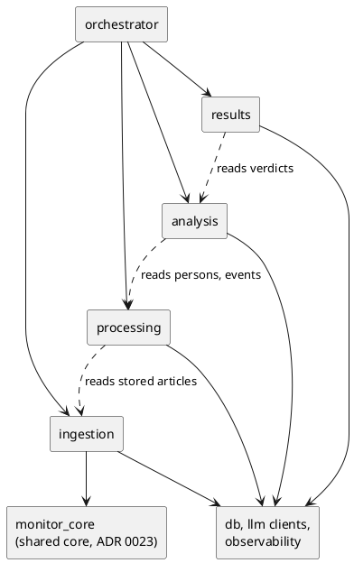

# Modularization plan

Status: in progress, 2026-10-11. Branch `refactor/modularization-prep`. Ingestion is
moved (item 2 of the migration sequence); nothing else is.

This document prepares the split of the code into four domain modules and an
orchestrator. It records what the code looks like today, where each file should end up,
which dependencies stand in the way, and the order of the pull requests that follow.
It moves no code by itself.

How the map was made: package and file imports were read from the AST of every file
under `src/`. `application.py`, `monitoring/service.py`, `monitoring/cli.py`,
`operator_console.py` and `web/ui/pipeline.py` were read. Every file of `entities/` was
classified from its module docstring, its public names, the ORM tables it writes, its
use of a model and its callers; their bodies were not read line by line, so the
`entities/` targets below are proposals to confirm when that pipeline is taken apart.

## Current architecture

### Two pipelines

The repository holds two pipelines. They share ingestion and extraction and part ways
after it.

**A. The monitoring pipeline** (`monitoring.service.MonitoringService`, ADR 0013). It
works on canonical persons (`persons`, ADR 0004).

```text
discover -> ingest -> extract -> resolve          (per source)
review entities -> classify -> RF match -> findings   (derived, global)
```

Run by Dagster (`monitoring/dagster`), by the CLI (`monitor`, `monitor-derived`,
`monitor-resolve`) and through the monitoring API.

**B. The operator cycle** («Рабочий цикл», ADR 0021, `docs/wiki/Pipeline.md`). It works
on entity groups (`entity_groups`, rebuilt whole and identified by an entity key), not on
canonical persons.

```text
1. load      monitor --catch-up --load-only   (pipeline A: discover, ingest, extract)
2. purge     purge-junk                       monitoring/junk_purge.py
3. entities  collect-entities                 entities/collector.py
4. figurants find-figurants                   entities/roles.py
5. political find-political                   entities/rf_check.py, politics.py, news.py,
                                              unnamed.py, sentences.py
```

Each step is a CLI command of `monitoring/cli.py`, started as a subprocess by
`operator_console.py`; the order of the steps lives in `web/ui/pipeline.py`.

The task this plan answers assumed `entities/` was a secondary, legacy path. That was
wrong. `docs/wiki/Pipeline.md` calls pipeline A after extraction «Старый путь: Person и
кандидаты» and says the console works with the entities of steps 3–5;
`web/ui/pipeline.py` says person resolution has no button. Both pipelines are in use:
pipeline A is what the automated monitoring and the findings run on, pipeline B is what
the operator console shows. They represent the same people by two different models,
canonical persons and entity groups.

Neither is the target. Which model stays after extraction — persons, entity groups, or
both as two views of one layer of data — is a separate architectural decision, and no
API in this plan may settle it by accident. So the module APIs written now cover only
what the two pipelines share: ingestion, and processing up to and including extraction.

```text
IngestionService      discover, fetch, parse, store   -> stored articles
ProcessingService     extract stored articles         -> extraction runs, mentions, events
                                                         (persisted in PostgreSQL)
after extraction:     person resolution (pipeline A)  |  entity groups (pipeline B)
```

### Two orchestrators

| Orchestrator | Where | Run state |
|---|---|---|
| Monitoring runs | `monitoring/service.py`, `repository.py`, `selection.py`, `locks.py`, `dagster/` | `monitoring_runs`, items, source checkpoints, advisory locks |
| Operator operations | `operator_console.py`, `web/ui/pipeline.py` | `operator_operation_runs` (ADR 0016), one live run per operation |

### What already fits the target

- `MonitoringService` coordinates and does not decide. Each stage selects its work from
  PostgreSQL, calls one domain service per unit of work (`ExtractionPipeline.run`,
  `resolve_extraction_run`, `classify_person`, `match_person`) and records counters and
  failed items on the run.
- Stage boundaries are persisted state: `monitoring/selection.py` answers "what is still
  pending" from the database, so a crashed run resumes without anything passed in memory.
- `application.py` is an explicit composition root: no registry, no service locator.
- `monitor_core` (ADR 0023) is a domain-free core for discover, fetch, parse and persist.

## Target architecture



Solid arrows are calls. Dotted arrows are reads of types or stored rows of an earlier
stage; they never start that stage's work.

A modular monolith: plain Python calls, one PostgreSQL database, no network protocol
between the modules, no message broker, no new scheduler.

## Responsibilities

| Module | Owns | Does not own |
|---|---|---|
| `ingestion` | source adapters and parsers, discovery, fetch, parse, storing documents and articles, which external ids are already stored | extraction, anything about persons |
| `processing` | mentions, events, normalization, entity resolution, canonical persons, evidence, human and AI review of resolution decisions, the junk screen and purge of articles | classification, list matching |
| `analysis` | persecution classification; Rosfinmonitoring snapshots and matching, kept as two separate subsystems inside the module | findings, reports |
| `results` | findings, candidates, queries, reports and exports | deciding verdicts |
| `orchestrator` | which stage runs when, the run lifecycle, checkpoints, locks, heartbeat, per-item failure records, retries, metrics, Dagster | any domain decision |
| `monitor_core` | generic ingestion models, ports and pipeline, the JSON-chat wire protocol, generic retry | court-specific code; `ingestion` depends on it and does not own it |

## Dependency rules

Allowed:

- `orchestrator` calls the public API of each domain module.
- A later stage reads types and stored rows of an earlier one:
  `processing -> ingestion`, `analysis -> processing`, `results -> analysis`,
  `results -> processing`.
- Every module uses `db`, `monitor_core`, the model clients (`llm/structured.py`,
  `llm/together_client.py`) and `observability`.
- Entry points (`application.py`, `settings.py`, `cli/`, `web/`, `api.py`, `main.py`,
  Dagster definitions) import anything: they are the wiring.

Forbidden:

- A domain module importing `orchestrator`.
- An earlier stage importing a later one: `ingestion -> processing | analysis | results`,
  `processing -> analysis | results`, `analysis -> results`.
- Shared code (`db`, `monitor_core`, model clients) importing a domain module.
- Domain code importing `evaluation` (tooling) or an entry point.

`tests/test_module_boundaries.py` enforces these rules on every import under `src/`,
with each file assigned to a module as in the map below. The five imports that break
them today are listed there as `KNOWN_VIOLATIONS`; a new one fails the test, and an
entry whose import is gone must be deleted. `entities/` is its own group in the test
(`operator_cycle`) until pipeline B is assigned.

## Data exchange

No new DTO is introduced. The existing ones in `monitoring/service.py` are enough:

| Type | Fields | Why it exists |
|---|---|---|
| `RunHandle` | `run_id`, `source`, `trigger`, `discovery_limit`, `refetch_known`, `published_from`, `published_to`, `resolve_only` | the identity and parameters of a run, passed to every stage; never article bodies |
| `DiscoveryResult` | `references`, `known_external_ids` | what discovery found and which of it is stored, so ingestion fetches only the new |
| `IngestionResult` | `article_ids`, `failed` | the articles this run stored, so extraction also takes the re-ingested ones |
| `StageResult` | `processed`, `created`, `skipped`, `failed`, `reviews`, `metrics` | counters for Dagster metadata and CLI output |

Everything else crosses a stage boundary as persisted state:

| Boundary | How the next stage finds its work |
|---|---|
| ingest -> extract | `articles_pending_extraction` (plus `IngestionResult.article_ids`) |
| extract -> resolve | `extraction_runs_pending_resolution` |
| resolve -> review | pending ER decisions, read by `AutomatedEntityReviewService.review_pending` |
| review -> classify | `persons_pending_classification` |
| classify -> RF match | `persons_pending_rf_match` for the latest imported snapshot |
| RF match -> findings | the snapshot id; `MonitoringFindingService.evaluate` reads the rest |

Domain services take ids and return small values. No SQLAlchemy session and no ORM
object graph crosses a module boundary.

## Public APIs

Two services exist now: `ingestion.service.IngestionService` and
`processing.ProcessingService`. Both are thin classes over the existing
implementation, built by `application.build_ingestion_service` and
`application.build_processing_service`. `MonitoringService` does not call them yet; it
is switched in the orchestrator pull request. Until then
`tests/monitoring/test_module_facades.py` holds them to it: what the facades store is
what a monitoring run of the same source finds already done.

```python
class IngestionService:
    def known_external_ids(self, source: str, external_ids: Sequence[str]) -> set[str]: ...
    async def discover(
        self, source: str, *, limit: int, stop_at_known: bool = False
    ) -> list[SourceReference]: ...
    def open(self, source: str) -> AsyncContextManager[IngestionPipeline[SqlAlchemyPersistenceResult]]: ...


class ProcessingService:
    def articles_pending_extraction(self, *, source_base_url: str) -> list[int]: ...
    def extract_article(self, article_id: int) -> ExtractionSaveResult: ...
```

Why they look like this:

- One unit of work per call. The loop over documents and articles, the heartbeat, the
  record of a failed item and the counters are coordination and stay with the caller. A
  `collect()` that returned only counts would lose the error of each failed document,
  which the run records today.
- `IngestionService.open` yields the existing `monitor_core` pipeline over one HTTP
  client: `read` a reference, then `save` it. The caller decides between the two, as
  `MonitoringService` does for the publication date.
- `ProcessingService` returns no person ids and knows nothing of entity groups. Its
  outcome is the persisted extraction run; `extract_article` returns the existing
  `ExtractionSaveResult` for the caller's counters.
- No new DTO. `StoredDocuments` and `PendingExtraction` are two small protocols for the
  "what is stored" and "what is pending" queries, which still live in
  `monitoring/selection.py`; the composition root passes that class in, so the facades
  do not import the orchestrator.

Temporary, until `MonitoringService` is switched: `IngestionService.discover` repeats
`MonitoringService._discover_references`.

`AnalysisService` and `ResultsService` are not written. Both depend on the model chosen
after extraction. When they are, the operations they would wrap in pipeline A are:

| Service | Operations | Existing code behind it |
|---|---|---|
| resolution (processing, pipeline A) | extraction runs pending resolution; resolve one run; AI review of pending decisions | `ExtractionResolutionService`, `AutomatedEntityReviewService` |
| `AnalysisService` | persons pending classification; classify one person; latest imported snapshot; persons pending RF match; match one person and store the result | `PersecutionClassificationService`, `RuleBasedRosfinmonitoringMatcher`, `RosfinMatchPersistence`, `SqlAlchemyRosfinmonitoringSnapshotLookup` |
| `ResultsService` | evaluate findings of a run; list findings | `MonitoringFindingService`, `candidates.service` |

## File migration map

Risk: low = moves with import fixes only; medium = has cross-module imports to untangle
first; high = mixes responsibilities or belongs to pipeline B.

### Packages

| Current path | Target module | Notes | Risk |
|---|---|---|---|
| `ingestion/sources/*` | ingestion | moved from `sources/`; `MEMOPZK_REGISTRY_SOURCE_NAME` now lives in `ingestion/sources/memopzk` and `extraction.models` imports it from there | done |
| `ingestion/service.py` | ingestion | the facade, over `ingestion.sources` | done |
| `monitor_core/ingestion`, `model`, `ports` | shared core | stays (ADR 0023); `ingestion` depends on it | none |
| `monitor_core/llm`, `retry.py`, `errors.py` | shared core | stays | none |
| `extraction/*` | processing | `resolution_service.py` and `parallel_resolution.py` import `persons`: internal once both are in `processing` | low |
| `persons/*` | processing | `resolution/ai_factory.py` imports the reviewers in `llm` | medium |
| `persons/resolution/evaluation.py`, `persons/er_evaluation.py` | evaluation tooling | `evaluation.py` imports `evaluation.person_resolution`; imported by `persons/resolution/cli.py` | medium |
| `llm/cli_reviewer.py`, `llm/entity_reviewer.py` | processing | implement the `persons.resolution.ai_review` contract; moving them ends the `persons <-> llm` cycle | low |
| `llm/structured.py`, `llm/together_client.py` | shared infrastructure | provider clients | none |
| `persecution/*` | analysis | reads `extraction.events` | low |
| `persecution/evaluation.py`, `rosfinmonitoring/match_evaluation.py` | evaluation tooling | | low |
| `rosfinmonitoring/*` | analysis | separate subsystem inside the module | low |
| `rosfinmonitoring/operator_table.py` | analysis | imports `airtable.client`, `airtable.share` | medium |
| `candidates/*` | results | | low |
| `db/*` | shared infrastructure | one declarative base, models by domain | none |
| `airtable/*` | shared: reference data sync | `repository.py` imports `extraction.normalizers`; outside the four modules | medium |
| `evaluation/*` | tooling | imports every domain package and `application` | none |
| `observability.py`, `health.py` | shared infrastructure | `health.py` imports `monitoring.models` | low |
| `settings.py` | entry point (configuration) | imports settings types of `monitoring`, `persons`, `llm`, `ingestion` | medium |
| `application.py` | entry point (composition root) | grows a builder per module | low |
| `api.py`, `main.py`, `cli/*`, `cli_batches.py`, `cli_progress.py`, `web/*` | entry point | `web` imports `entities` in 98 places | none |
| `operator_console.py` | orchestrator (operator operations) | second orchestrator; not merged with monitoring runs in this plan | high |
| `research`, `search`, `semantic_retrieval`, `platform_api`, `telegram_bot`, `channel_feed`, `static` | none | empty on `main`: only `__pycache__` | none |

### `monitoring/`

| Current path | Target module | Notes | Risk |
|---|---|---|---|
| `service.py` | orchestrator | stage loops, run lifecycle; also holds the DTOs | medium |
| `repository.py` | orchestrator | runs, failed items, checkpoints | low |
| `selection.py` | orchestrator, then split | each "pending" query knows the tables of one domain module; the facades expose them, the SQL moves later | medium |
| `locks.py` | orchestrator | advisory locks | low |
| `models.py` | orchestrator | `MonitoringSettings` is imported by `settings.py`; finding views belong to `results` | medium |
| `dagster/*` | orchestrator | `resources.py` imports `application` | low |
| `findings.py` | results | imports `candidates`, `persecution.queries` | low |
| `junk_purge.py`, `junk_screen.py`, `junk_holds.py`, `hold_reader.py`, `decision_screen.py`, `embedder.py`, `article_screen.py` | processing | the decision "this article is junk" and its purge; step 2 of pipeline B | high |
| `cli.py` | entry point | starts both pipelines and wires every step of pipeline B | high |

### `entities/` (pipeline B)

Proposed targets, to confirm when this pipeline is taken apart. "Writes" names ORM
tables the file changes; "Model" means it asks a language model.

| File | What it does | Writes | Model | Callers | Later target |
|---|---|---|---|---|---|
| `collector.py` | rebuilds every entity group from mentions in one transaction | `entity_group*`, name normalizations, unnamed mentions | yes | CLI | processing |
| `grouping.py` | pure rules: mentions to entities by name forms | none | no | `web/ui` | processing |
| `normalizer.py` | names to the nominative by a model | none | yes | CLI | processing |
| `overrides.py` | operator's corrections of names, by entity key | name overrides | no | `web` | processing (review) |
| `removals.py` | operator's removal of an entity, by entity key | removals | no | `web` | processing (review) |
| `disputes.py` | pairs that may be one person, and the operator's decision | pair decisions, merges | no | `web/ui` | processing (review) |
| `roles.py` | figurant or only mentioned: rules, then a model | roles, role answers, role decisions | yes | CLI, `web/ui` | processing |
| `officials.py` | officials among the entities, and the operator's mark | official marks | no | `web` | processing |
| `digest.py` | which articles describe a person's own case | digest answers | yes | CLI | processing |
| `unnamed.py` | unnamed figurants and their candidates on the list | unnamed figurants, answers, decisions | yes | CLI, `web` | split: reading is processing, list candidates are analysis |
| `sentences.py` | reads sentences from articles into rows | article sentences | yes | CLI | processing |
| `news.py` | latest news of a political case: new case, sentence, more | entity news, answers | yes | CLI, `web` | analysis |
| `politics.py` | political persecution or common crime: rules, then a model | politics, answers, decisions | yes | CLI, `web` | analysis; a second classifier beside `persecution` |
| `rf_check.py` | downloads the list, matches entities by name | entity RF matches | no | CLI, `web` | analysis; a second matcher beside `rosfinmonitoring.matcher` |
| `rf_entry.py`, `rf_articles.py` | the matched entry in words; articles a person is listed for | none | no | `web` | analysis |
| `base_candidates.py`, `named_candidates.py` | who an unnamed figurant may be: the operator's base, other publications | none | no | `web` | analysis |
| `base_unnamed.py` | who on the list a nameless record of the base may be | unnamed decisions | no | `web` | analysis |
| `known_base.py`, `known_nameless.py` | whether the operator's base already holds a person | none | no | `web/ui` | analysis |
| `jurisdiction.py` | which court tries a case, from the base's history | none | no | `web` | analysis |
| `sentence_cases.py`, `unnamed_cases.py` | rows folded into cases for the result and the counts | none | no | `web` | results |
| `ask.py` | «Спросить»: a model picks ready counts, code runs them | chat questions | yes | `web` | results |
| `done_marks.py` | operator's «Обработано» mark | none | no | `web/ui` | results |
| `evidence.py` | one SQL CTE for publication evidence | none | no | `web` | results |
| `regions.py` | canonical names of regions | none | no | `web/ui`, `sentences`, `ask` | shared reference data |
| `llm.py` | one way to ask a model for JSON: endpoint, spend, batches | none | yes | steps, `monitoring/hold_reader.py`, `evaluation`, `web/ui` | shared infrastructure |
| `answers.py` | cache of model answers by question hash | answer tables | yes | steps | stays with the steps that use it |
| `compare.py` | compares a cheaper model with the trusted one on a sample | none | yes | CLI | evaluation tooling |

Recommendation for `entities/`:

1. Do not scatter it across `processing`, `analysis` and `results` yet. Its files share
   one identity model (the entity key), one answer cache, one model client and the
   operator's decisions kept by key. That is the shape of a bounded context of its own.
2. Decide first whether canonical persons or entity groups are the model the product
   keeps. Pipeline B repeats, on entity groups, what `persecution` and `rosfinmonitoring`
   do on persons. Moving both into `analysis` as they are would put two classifiers and
   two matchers in one module.
3. Whatever is decided, three parts can leave early at low risk: `llm.py` to shared
   infrastructure, `regions.py` to shared reference data, `compare.py` to evaluation.

## Dangerous dependencies

| Dependency | Why it stands in the way | Proposed fix |
|---|---|---|
| `entities <-> monitoring` | `collector.py`, `unnamed.py` import `CRIMINAL_EVENT_TYPES` from `monitoring.junk_purge`; `roles.py` imports `EXTRACTOR_NAME` from `monitoring.hold_reader`; `hold_reader.py` imports `entities.llm` | move the junk files to `processing`, `entities/llm.py` to shared |
| `persons <-> llm` | `ai_factory.py` imports the reviewers, the reviewers import the contract | move the two reviewers next to the contract |
| `persons -> evaluation` | domain code imports tooling | move `persons/resolution/evaluation.py` under `evaluation` |
| `airtable -> extraction.normalizers` | shared code imports `processing` | find what is used; move the helper down or the caller up |
| `rosfinmonitoring -> airtable` | `analysis` depends on the reference sync client | acceptable if `airtable` stays shared; decide with the item above |
| `settings -> monitoring, persons, llm, ingestion` | one module validates every package's settings | acceptable for an entry point; it must not be imported by domain code |
| `monitoring/models.py` | holds run types, `MonitoringSettings` and the finding views together | split when `results` is extracted |
| `monitoring/selection.py` | one class holds the pending queries of three modules | each facade exposes its own; move the SQL with its module |
| `monitoring/cli.py` | one file wires pipeline A and every step of pipeline B | split by pipeline when the CLI is switched |
| publication date filter in `MonitoringService._ingest_references` | a rule about which documents to keep sits between `read` and `save` in the orchestrator | move behind `IngestionService` when `MonitoringService` is switched to it, behaviour unchanged |
| `persons_linked` arithmetic in `MonitoringService.resolve` | a counter derived from resolution statistics in the orchestrator | leave; it is reporting, not a decision |
| `web -> entities` (98 imports) | the console reads pipeline B directly, with no service in between | out of scope until pipeline B is decided |

## Migration sequence

Each item is one pull request. None changes behaviour, the database schema or a domain
algorithm.

1. **This one.** The plan; `tests/test_module_boundaries.py`, which freezes the imports
   that break the rules today in an allowlist and fails on a new one; the ingestion and
   processing facades with their test.
2. **Ingestion.** Done: `sources/` is `ingestion/sources/`, and the registry's source
   name is defined there. The `ingestion` package imports nothing on load, so
   `extraction.models` can read that name without loading every adapter; callers import
   `ingestion.service.IngestionService`. Left for the orchestrator pull request: the
   publication date filter behind `IngestionService`. Tests stay in `tests/sources/`.
3. **Processing, extraction part.** `extraction/` and the junk screen files.
   Then the decision on the model after extraction (persons, entity groups, or both).
   Items 4–6 follow that decision and are written here for pipeline A as it stands.
4. **Processing, resolution part.** `persons/`, the two reviewers;
   `persons/resolution/evaluation.py` to `evaluation/`.
5. **Analysis.** `persecution/` and `rosfinmonitoring/` as two sub-packages; the
   `airtable` dependency settled.
6. **Results.** `candidates/`, `monitoring/findings.py`, the finding views.
7. **Orchestrator.** `monitoring/` run code under `orchestrator/`, calling only the four
   facades; `selection.py` split by module.
8. **CLI** switched to the facades; `monitoring/cli.py` split by pipeline.
9. **API** switched.
10. **Dagster** switched.
11. **Legacy orchestration removed**: the old `MonitoringDependencies` wiring.
12. **Cleanup**: the allowlist of the import test reaches empty.

Pipeline B is planned separately, after the same decision.
LangGraph orchestration comes after step 12 and is not part of this sequence.
