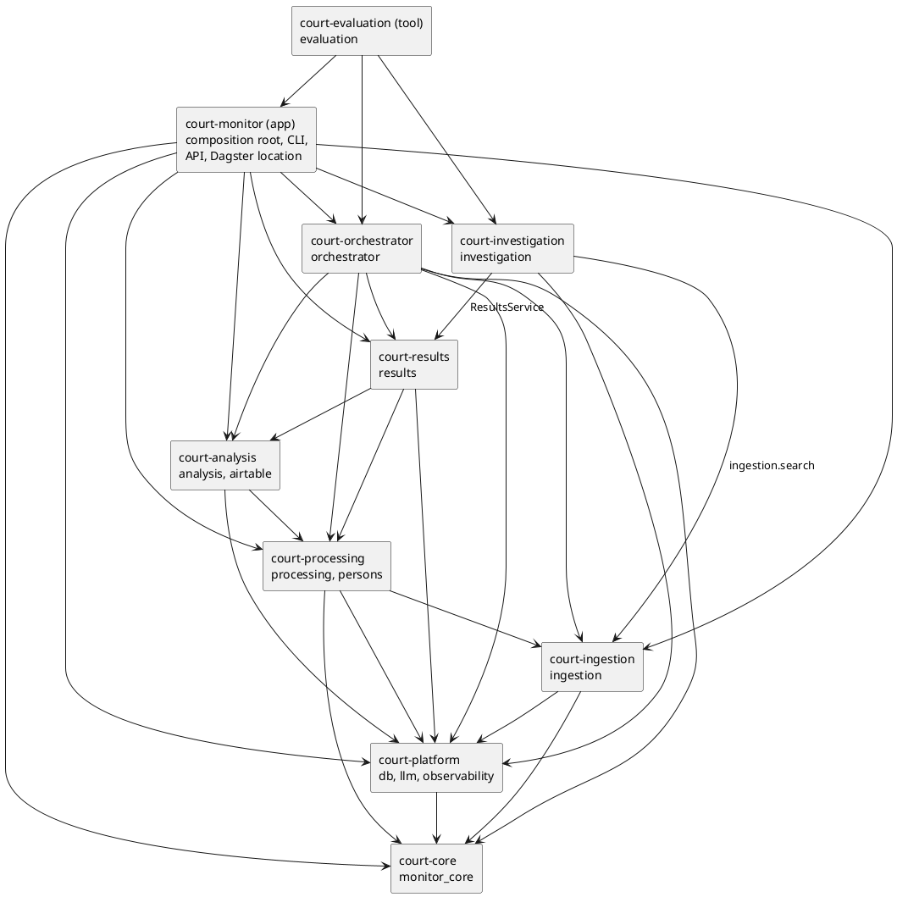

# Package map

Status: current, 2026-10-17 (branch `refactor/workspace-packages`).

The repository is one [uv workspace](https://docs.astral.sh/uv/concepts/projects/workspaces/):
the modules of [ADR 0025](../adr/0025-modular-monolith-and-pipeline-orchestrator.md) are
separate installable distributions, each with its own `pyproject.toml` and the
dependencies it declares. They stay plain Python packages of one process (or one set of
processes): calls between them are typed Python calls, there is one PostgreSQL database,
no network protocol, no broker, no container per package. A package is not a
microservice.

The import names did not change: `import ingestion`, `import processing`, … A
distribution's name (`court-ingestion`) is not its import name (`ingestion`).

`tests/test_package_graph.py` holds this map to the code: the allowed workspace
dependencies of each distribution (`MAY_DEPEND_ON`), no cycle, every import declared by
the distribution that makes it. `tests/test_module_boundaries.py` keeps the finer rules
between modules (public APIs, internals, the console's read models), as before.
`scripts/check_package_isolation.py` (CI job `packages`) builds every wheel and checks
it carries every file of its `src/`, then installs each distribution's wheel alone (with
the wheels of its workspace dependencies and their locked libraries, not the checkout),
imports every module it ships there and runs its own tests.

## Layout

```text
pyproject.toml            the workspace: members, dev tools, ruff/mypy/pytest config
uv.lock
packages/
  court-core/             src/monitor_core
  court-platform/         src/db, src/llm, src/observability.py
  court-ingestion/        src/ingestion                   tests/
  court-processing/       src/processing, src/persons     tests/
  court-analysis/         src/analysis, src/airtable      tests/
  court-results/          src/results
  court-investigation/    src/investigation
  court-orchestrator/     src/orchestrator
apps/
  court-monitor/          src/application.py, settings.py, main.py, api.py,
                          cli/, web/ (+ web/static/), cli_batches.py, cli_progress.py,
                          dagster_location/
tools/
  court-evaluation/       src/evaluation
tests/                    cross-module, application and database tests; support/
scripts/                  check_package_isolation.py
migrations/, alembic.ini  the one database's history (unchanged)
frontend/                 the React console (unchanged; served by the API)
```

`packages/*/tests` hold the tests that need nothing of `tests/` (no database, fixtures
or `support` helpers). The rest stay in `tests/`, in the directories named after the old
packages.

## Dependency graph

The workspace dependencies each `pyproject.toml` declares (solid), as they are now.



The same as text:

```text
court-core
  ↑
court-platform ─────────────────────────────┐
  ↑                                          │
court-ingestion ←──────────────┐             │
  ↑                            │             │
court-processing               │             │
  ↑                            │             │
court-analysis                 │             │
  ↑                            │             │
court-results ←── court-investigation (results + ingestion.search)
  ↑
court-orchestrator → ingestion, processing, analysis, results (public APIs)

court-monitor (app)  → every package above; the only one that builds the graph
court-evaluation     → the app and every package; nothing depends on it
```

What may not be (each a test of `tests/test_package_graph.py`, transitively):

- an earlier stage on a later one: ingestion on processing, analysis, results;
  processing on analysis, results; analysis on results;
- any domain package (ingestion, processing, analysis, results, investigation) on the
  orchestrator or the application;
- the investigation on the orchestrator, the orchestrator on the investigation;
- anything in production on `court-evaluation`; anything but the tooling on the app;
- the core on anything of the workspace, the platform on any module.

## The distributions

### court-core

| | |
|---|---|
| Workspace dependencies | none |
| Libraries | httpx, pydantic |
| Public API | `monitor_core.errors`, `monitor_core.ingestion`, `monitor_core.llm`, `monitor_core.model`, `monitor_core.ports`, `monitor_core.retry` (ADR 0023; `tests/monitor_core/test_monitor_core_boundary.py`) |
| Owns | no table, no court-specific code: generic ingestion models and pipeline, ports, generic retry, the JSON-chat wire protocol |
| Called by | ingestion, processing, orchestrator, platform (`llm`), the app |

### court-platform

| | |
|---|---|
| Workspace dependencies | court-core |
| Libraries | httpx[socks], psycopg[binary], pydantic, sqlalchemy |
| Public API | `db.database` (engine, sessions, pool settings), `db.orm_models` / `db.models.*` (the ORM of the one database), `db.locks`, `db.maintenance`, `db.investigation_runs`; `llm.chat`, `llm.structured`, `llm.together_client`, `llm.model_choice`; `observability` |
| Owns | the ORM definitions of every table, centrally (ownership of tables by module is a later task); `app_settings`, `entity_model_spend` (the model choice and its spend) |
| Called by | every other distribution |

Infrastructure, not a domain: it imports no module (`SHARED` in the boundary test).

### court-ingestion

| | |
|---|---|
| Workspace dependencies | court-core, court-platform |
| Libraries | httpx, pydantic, selectolax, sqlalchemy |
| Public API | `ingestion.service.IngestionService`; `ingestion.sources.source_registry` (the sources' names and kinds); `ingestion.search` (the read-only search of configured sources, for the investigation); `ingestion.concurrency` (fetch limits, for the composition root) |
| Owns | `sources`, `source_documents`, `parsed_articles`: what was discovered, fetched and parsed |
| Called by | the orchestrator, processing (`processing.extraction.models` reads a source name), the investigation (`ingestion.search`), the app |

### court-processing

| | |
|---|---|
| Workspace dependencies | court-core, court-platform, court-ingestion |
| Libraries | anthropic, httpx, pydantic, pymorphy3, rapidfuzz, sqlalchemy; extra `semantic`: sentence-transformers, torch |
| Public API | `processing.service.ProcessingService`, `processing.identity.service.IdentityService`, `persons.resolution.stage.PersonResolutionStage`; the console's read models listed in `CONSOLE_READ_MODELS` |
| Owns | extraction (`article_extraction_runs`, `entity_mentions`, `extracted_events`, `event_entity_mentions`), entity groups and their decisions (`entity_groups*`, `entity_role_*`, `entity_pair_decisions`, `entity_name_*`, `entity_removals`, …), evidence (`article_sentences`, `article_sentence_readings`, `article_digest_answers`), the junk screen (`junk_screen_holds`), ER v2 (`persons`, `person_*`, `review_records`) |
| Called by | the orchestrator, analysis, results, the app |

The `semantic` extra is the junk screen's embedding mode (`JUNK_SCREEN=1`). It is
loaded lazily by `processing.junk.embedder`; nothing else needs it installed.

### court-analysis

| | |
|---|---|
| Workspace dependencies | court-platform, court-processing |
| Libraries | curl-cffi, httpx, pyarrow, pydantic, rapidfuzz, sqlalchemy |
| Public API | `analysis.service.AnalysisService`; `airtable.service`; the vocabularies and read models in `CONSOLE_READ_MODELS` |
| Owns | politics (`entity_group_politics`, `entity_politics_*`), the Rosfinmonitoring list (`rosfinmonitoring_*`, `rfm_operator_entries`, `rosfin_matches`, `entity_group_rf_matches`), case news (`entity_group_news`, `entity_news_answers`), unnamed figurants (`unnamed_*`), persecution of persons (`persecution_classifications`), the operator's reference lists (`airtable_known_persons`, `criminal_articles`, `excluded_persons`) |
| Called by | the orchestrator, results, the app |

### court-results

| | |
|---|---|
| Workspace dependencies | court-platform, court-processing, court-analysis |
| Libraries | httpx, pydantic, pymorphy3, sqlalchemy |
| Public API | `results.service.ResultsService`; `results.candidates.service`; the read models in `CONSOLE_READ_MODELS` (`results.models`, `results.ask`, `results.done_marks`, `results.queries.*`) |
| Owns | `monitoring_findings`, `entity_done_marks`, `chat_questions` (the operator's questions) |
| Called by | the orchestrator, the investigation, the app |

### court-investigation

| | |
|---|---|
| Workspace dependencies | court-platform, court-ingestion, court-results |
| Libraries | httpx, langchain-core, langgraph, pydantic, pymorphy3 |
| Public API | `investigation.service.InvestigationService` |
| Owns | `investigation_runs` (through `db.investigation_runs`, given by the app) |
| Called by | the app (CLI `investigate`, `POST /api/v1/investigation`) |

Not part of the monitoring pipeline. It reads only `results.service` and
`ingestion.search` (`INVESTIGATION_MAY_IMPORT`), runs no SQL of its own and never
imports ER v2.

### court-orchestrator

| | |
|---|---|
| Workspace dependencies | court-core, court-platform, court-ingestion, court-processing, court-analysis, court-results |
| Libraries | dagster, httpx, pydantic, sqlalchemy |
| Public API | `orchestrator.service.MonitoringService`, `orchestrator.cycle.OperatorCycle`, `orchestrator.runs.MonitoringRuns`, `orchestrator.operations.OperationRegistry` (with `CommandLine`), `orchestrator.models`; `orchestrator.dagster` (assets, jobs, schedules) |
| Owns | `monitoring_runs`, `monitoring_run_items`, `source_monitoring_state`, `operator_operation_runs`, the advisory locks |
| Called by | the app (CLI, API, Dagster's code location) |

It reaches the domain only through `ORCHESTRATOR_MAY_IMPORT`: the five facades and the
source registry. It is given its `CommandLine` (how an operator operation starts the
application's command line) by the app; it does not know where the app is installed.

### court-monitor (application)

| | |
|---|---|
| Workspace dependencies | every package |
| Libraries | alembic, dagster, dagster-postgres, dagster-webserver, fastapi, httpx, markdown-it-py, openpyxl, pydantic, sqlalchemy, uvicorn, weasyprint; extra `semantic` (= court-processing[semantic]) |
| Entry points | `court-monitor <command>` (console script) = `python apps/court-monitor/src/main.py <command>`; `uvicorn api:app`; `dagster … -m dagster_location.definitions` (`docker/dagster/workspace.yaml`); `alembic upgrade head` |
| Owns | the composition root (`application.py`, `settings.py`): the only place that knows the concrete classes (`SqlAlchemy…`, `RuleBased…`, `OpenRouter…`, `WebsiteAdapter`) |

Its wheel carries all of its code and `web/static/` (package data), and imports from a
plain install.
Deployed, it runs from the repository: `docs/wiki`, `migrations` and `alembic.ini` are
read from the checkout, so the image installs it editable (`uv sync`), as a working copy
does.

### court-evaluation (tooling)

| | |
|---|---|
| Workspace dependencies | the app and every package |
| Libraries | httpx, pydantic, sqlalchemy; extra `semantic`: court-processing[semantic], numpy, scikit-learn |
| Entry points | `court-evaluation <command>` = `python -m evaluation <command>`: `evaluate-er`, `evaluate-final`, `build-real-world-corpus`, `real-world-corpus-status`, `real-world-golden`, `evaluate-real-world`, `compare-entity-models`; the `python -m evaluation.<study>` modules |
| Owns | no table; disposable databases only (`EVALUATION_DATABASE_URL`) |

Not in the image. Before the split its commands were part of `python src/main.py`.

## What was moved, and why

| Was | Is | Why |
|---|---|---|
| `src/monitor_core` | `packages/court-core/src/monitor_core` | |
| `src/db`, `src/llm`, `src/observability.py` | `packages/court-platform/src/…` | |
| `src/llm/cli_reviewer.py`, `src/llm/entity_reviewer.py` | `persons/resolution/cli_reviewer.py`, `entity_reviewer.py` | they implement and import a contract of `persons`: in `llm` the platform would depend on processing (the boundary test already counted them as processing) |
| `src/ingestion` | `packages/court-ingestion/src/ingestion` | |
| `src/processing`, `src/persons` | `packages/court-processing/src/…` | |
| `src/persons/resolution/cli.py` | `apps/court-monitor/src/cli/person_resolution.py` | an entry point inside the domain that imported the evaluation |
| `evaluate-er` (in that file) | `evaluation/person_resolution/cli.py` | tooling |
| `pipeline_identity` (`evaluation/person_resolution/er_run.py`) | `persons/resolution/surface.py` | the production command `resolve-person` used it: ER's own input, not evaluation |
| `src/analysis`, `src/airtable` | `packages/court-analysis/src/…` | |
| `src/results` | `packages/court-results/src/results` | |
| `src/investigation` | `packages/court-investigation/src/investigation` | |
| `src/orchestrator` | `packages/court-orchestrator/src/orchestrator` | |
| `src/orchestrator/dagster/definitions.py`, `resources.py` | `apps/court-monitor/src/dagster_location/` | they build the application graph: wiring, not orchestration (they were `ENTRY_POINT` in the boundary test) |
| `OperationRegistry` computing `src/main.py` from its own path | `CommandLine` given by `web.dependencies` | the orchestrator knew where the app is installed |
| `src/application.py`, `settings.py`, `main.py`, `api.py`, `cli/`, `web/`, `cli_batches.py`, `cli_progress.py` | `apps/court-monitor/src/…` | |
| `src/static/` | `apps/court-monitor/src/web/static/` | package data of `web`: the wheel carries it, an editable install reads it in place |
| `src/evaluation` | `tools/court-evaluation/src/evaluation` | |
| evaluation commands of `python src/main.py` | `court-evaluation` | production must not depend on the evaluation |

Nothing in the database changed: no migration, no table moved, the Alembic history is
the same.
