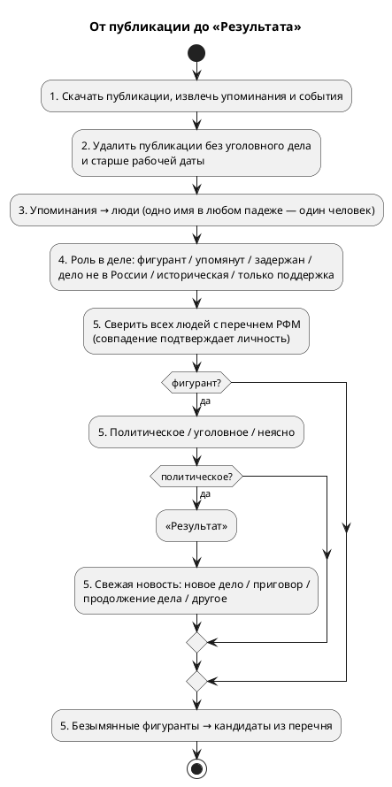

# Pipeline

## Зачем это нужно

Pipeline — путь от публикации до «Результата»: списка людей, против которых
российские власти возбудили политическое уголовное дело. Оператор ведёт его по
кругу из пяти шагов на странице «Рабочий цикл», разбирая проверки между шагами.
Каждый шаг — отдельный запуск; полная карточка и лог находятся в «Журнале
запусков». Нажать можно только текущий шаг.

Перечень Росфинмониторинга никого не отсеивает: он подтверждает личность (дата
рождения и место), см. [Rosfinmonitoring](Rosfinmonitoring.md).

## Быстрый сценарий

1. Открыть <http://127.0.0.1:8001/ui/cycle>.
2. Нажать «Сделать всё»: оставшиеся шаги пройдут подряд. Состояние видно на этой же
   странице, полные сведения и кнопки отдельных шагов — в
   [журнале запусков](http://127.0.0.1:8001/ui/runs).
3. Между шагами разобрать станцию с ненулевым счётчиком. Незакрытая предыдущая
   проверка не блокирует запуск, но требует подтверждения.
4. После шага 5 проверить политичность и безымянных, затем открыть «Результат».

Те же шаги из командной строки (внутри контейнера API):

```bash
docker exec ebnv-api-1 sh -c 'cd /app && /opt/venv/bin/court-monitor purge-junk'
docker exec ebnv-api-1 sh -c 'cd /app && /opt/venv/bin/court-monitor collect-entities'
docker exec ebnv-api-1 sh -c 'cd /app && /opt/venv/bin/court-monitor find-figurants'
docker exec ebnv-api-1 sh -c 'cd /app && /opt/venv/bin/court-monitor find-political'
```

Команды, запущенные так, не создают карточку запуска и не двигают круг шагов в UI.

### Сделать всё

Кнопка «Сделать всё» на странице «Работа» и над шагами в «Журнале запусков» выполняет все
оставшиеся шаги подряд — от того, чья сейчас очередь, до пятого. Каждый шаг остаётся
отдельным запуском со своей карточкой и журналом; когда он завершился успешно, следующий
запускается сам (`OperationParameters.chain`, `OperationRegistry._continue_chain`).

Цепочка останавливается, если шаг упал, был остановлен кнопкой или потерян при перезапуске
сервера: оператор смотрит, что случилось, и нажимает «Сделать всё» ещё раз — оно продолжит с
того же шага. Страница говорит об этом сама: «„Сделать всё“ остановилось на шаге N» — с
причиной; в карточке запуска стоит «шаг цепочки „Сделать всё“».

Загрузка — особый случай. Она считается упавшей, когда не ответил хотя бы один источник, и
из кода возврата не видно, один он был или все. Цепочка идёт дальше, только если загрузка
точно что-то сделала: хотя бы один источник в этом запуске дошёл до конца
(`monitoring_runs`), и ни один не был пропущен из-за другой идущей загрузки (код 3, загрузка
по расписанию). Иначе цепочка стоит: шаг 2 удаляет необратимо, шаги 3–5 платные, и запускать
их самим по результатам прошлой загрузки нельзя. Вручную оператор может продолжить и после
такой загрузки — это его решение.

Одно нажатие — одна цепочка. Кнопка называет последний запуск, для которого нарисована её
страница (`after`), и сервер запускает цепочку, только пока этот запуск остаётся последним.
Форма, отправленная повторно из истории браузера после того, как круг прошёл, получает
отказ «нажатие устарело» — иначе она начала бы новый круг с удалением и расходами, никого
не спросив.

«Остановить» относится к цепочке, а не к номеру запуска: если шаг закончился за миг до
нажатия и цепочка уже запустила следующий, останавливается следующий.

Остановка посылает процессу шага SIGINT: CLI закрывает свои запуски мониторинга и выходит.
Если за 30 секунд (`STOP_GRACE`) процесс не вышел, он получает SIGKILL и ничего не закрывает.
Поэтому API нельзя запускать с отключённым SIGINT: процесс шага наследует это отключение,
не услышит остановку и будет убит через 30 секунд. Так выходит, если поднять API фоном
через `&` из скрипта (`nohup uvicorn … &`). Образ запускает `uvicorn` exec-формой `CMD`, там
SIGINT работает.

Перед запуском браузер спрашивает один раз за все шаги: про необратимое удаление на шаге 2 и
про стоимость каждого платного шага. Лимит расходов у каждого шага свой, как при запуске по
одному; если остаток на счёте меньше суммы лимитов, вопрос это говорит. У шага 2 лимита нет
(оплата за каждую статью), в сумму он не входит. Кнопки отдельных шагов остались в «Журнале запусков».

## Пять шагов

| Шаг | Кнопка / команда | Что делает | Что пишет |
|---|---|---|---|
| 1 | «Подгрузить статьи», `monitor --catch-up --load-only` | скачивает новые публикации всех новостных источников, извлекает упоминания и события | `source_documents`, `parsed_articles`, `entity_mentions`, `extracted_events` |
| 2 | «Очистить от мусора», `purge-junk` | удаляет публикации без уголовного события и опубликованные до рабочей даты | удаляет строки; от поста остаётся пустая запись, чтобы не скачивать его снова |
| 3 | «Собрать сущности», `collect-entities` | сводит упоминания в людей, приводит имена к именительному падежу, заново применяет опознания безымянных, связывает людей со статьями УК | `entity_groups`, `entity_group_mentions`, `entity_group_unnamed_mentions`, `entity_group_charges` |
| 4 | «Найти фигурантов», `find-figurants` | определяет роль каждого человека в деле | `entity_group_roles` |
| 5 | «Отобрать политические дела и сверить с РФМ», `find-political` | сверяет людей со свежим перечнем, отделяет политическое преследование от обычной уголовщины, называет свежую новость политического дела, ищет безымянных фигурантов и выписывает приговоры из публикаций ([Ask](Ask.md)) | `entity_group_rf_matches`, снимок перечня, `entity_group_politics`, `entity_group_news`, `unnamed_figurants`, `article_sentences` |

Опознания безымянных хранятся не в `entity_mentions`, а в
`unnamed_identity_resolutions`. Шаг 3 каждый раз материализует их в
`entity_group_unnamed_mentions`, поэтому решение переживает пересоздание
`entity_groups`.

После шага 5 круг начинается снова с шага 1. Запуск, оборванный или упавший на
шагах 2–5, повторяется; шаг 1 считается сделанным, даже если упал один из источников.

Между шагами цикл показывает: сбои извлечения (информация), отсев, пары, неясную
роль, неясную политичность и безымянных. Сбои не входят в счётчик. Роль и
политичность можно решить прямо на странице; решение хранится по ключу сущности
(`entity_role_decisions`, `entity_politics_decisions`) и применяется при следующей
пересборке шага 4 или 5. Опознание безымянного используется шагами 3–5 следующего
круга.

## Что происходит внутри



### Шаг 2: рабочая дата

`PIPELINE_SINCE` (в `compose.yaml`, сейчас `2026-09-20`) — с какой даты публикации
идёт работа. Шаг 2 удаляет всё опубликованное раньше, включая карточки реестра
«Мемориала»; их записи помечаются `application/x-court-monitor-expired` и не
считаются в воронке. Без переменной по дате ничего не удаляется.

С отсевом (`JUNK_SCREEN=jev` в `compose.yaml`; в коде по умолчанию выключен) статья без уголовного события, похожая
на новость о деле, удерживается на проверку вместо удаления — [Junk Screen](Junk-Screen.md).

### Шаг 3: как упоминания становятся людьми

`packages/court-processing/src/processing/identity/grouping.py`: одно имя и фамилия в любом падеже — один человек
(«Моора», «Моору», «Моор»); отчество отличает тёзок; фамилия без имени
присоединяется к полному имени из той же публикации. «Жене Владимира» — родство, не
человек; имя на последней строке после законченного текста («Никита Черненко»,
«Влад Никифоров, Иркутск») — подпись автора, не человек из новости;
«Дрион Алексис» и «Алексис Дрион» — один человек. Имена в именительный
падеж приводит правило, а в спорных случаях модель (`packages/court-processing/src/processing/identity/normalizer.py`).
Решения оператора — «Один человек», «Разные люди», исправленное имя, отметка
«должностное лицо» — хранятся по ключу и применяются при каждой пересборке.

### Шаг 4: роль в деле

`packages/court-processing/src/processing/roles/roles.py`. Должностных лиц (судьи, прокуроры, следователи) отмечают
правила. Остальных модель читает по цитатам и выбирает роль: обвиняемый в
российском деле (фигурант), административное дело, задержан или обыскан, дело не
в России, историческая репрессия, только поддержка (письма, акции, напоминание о
давнем приговоре), адвокат, свидетель и т. д. Люди из перечня тоже оцениваются.

### Шаг 5: политическое, РФМ или нет

Сначала `packages/court-analysis/src/analysis/rosfinmonitoring/rf_check.py` скачивает свежий перечень и сверяет сущности.
Перечень подтверждает личность, а не решает, политическое ли дело. Затем
`packages/court-analysis/src/analysis/politics/classification.py` применяет правила: статья УК из списка политических
(`analysis/persecution/classifier.py`), категория реестра «Мемориала» или только статьи
обычной уголовщины (без ст. 213 и 318). Остальных читает модель; неудавшийся ответ
— «неясно», никогда не «политическое».

Раньше всех правил смотрится база оператора (`analysis.operator_base.known_base.TrackedCases`). Если в
ней ровно одна запись с именем человека и у неё та же статья УК, что называют новости, —
это дело оператор уже ведёт как политическое, и вердикт «политическое» ставится с
основанием «база оператора», какая бы статья ни была: наркотическую статью против политолога
и правило, и модель читают как обычную уголовщину. Одного имени мало: из 22 «уголовных» с
единственной записью в базе 19 оказались тёзками (в базе терроризм, в новостях взятка), а
статья совпала у одного (замер 06.10.2026).

Модель получает две цитаты по 150 знаков с каждой стороны от имени. Такая цитата
режется по счётчику знаков и нередко обрывается перед самой сутью дела. Поэтому там,
где модель ответила «понять нельзя», тот же вопрос задаётся ей ещё раз с цитатами по
600 знаков (`WIDE_CONTEXT`). В вердикт, причину и цитату идёт ответ по широкой цитате.
На 23 «неясных» это оставило 2; из 100 уже решённых дел широкая цитата не изменила
ни одного (замер 06.10.2026, с разметкой человека не сверялось). В конце шага — поиск безымянных фигурантов
([Unnamed Figurants](Unnamed-Figurants.md)).

Человек, названный одним словом (одна фамилия или одно имя), проходит шаги
4 и 5 как все: шаг 4 решает, заведено ли на него дело, шаг 5 — политическое ли оно.
Обычное уголовное дело уходит без участия человека, но только по ответу модели: правило
«обычная уголовная статья» такую запись само не закрывает, а без ответа модели она
остаётся «не ясно». Политическое остаётся «не ясно» с причиной «дело политическое, но
человек назван одним словом»: кто это, решает оператор. Имя с инициалом («Алексей Е.»,
«Иванов И.») — это имя: так пресс-службы судов пишут тех, кого оператор и ищет, и их
политические дела идут в результат сразу. Раньше
любую такую запись шаг 4 сразу отправлял на ручной разбор, и взяточник, названный в
новости по фамилии, ждал в очереди непрочитанным.

### Шаг 5: новое дело или приговор

`packages/court-analysis/src/analysis/news/case_news.py`. Модель читает последние публикации о каждом политическом деле
(свежая первой, с датой) и называет, о чём свежая новость: **новое дело** (задержание,
возбуждение, обвинение — впервые), **приговор**, **продолжение дела** (продление
ареста, апелляция, этап старого дела), **дело завершено** (человек уже на свободе —
освобождён, обменян, отбыл срок, оправдан — или умер, а публикация вспоминает прошлое) или
**другое**. Без ответа модели — «не
определено», в следующий раз спросят снова. Ответы кэшируются по цитатам. На
«Результате» — колонка и фильтр «Свежая новость», в Excel — последняя колонка; в
досье — под «Ролью в деле». Отдельно, без остального шага:

```bash
docker exec ebnv-api-1 sh -c 'cd /app && /opt/venv/bin/court-monitor find-news'
```

## Модель и расходы

Шаги 3, 4 и 5 спрашивают модель через OpenRouter (`OPENROUTER_API_KEY`). Какую — выбирает
оператор на странице «Модель извлечения» ([Entity Model](Entity-Model.md)); пока не выбрана —
`ENTITY_NORMALIZE_MODEL`, по умолчанию `deepseek/deepseek-v4.1-flash`. Модель фиксируется
в запуске при старте, перед запуском показаны её цены.

- Ответы кэшируются по вопросу (`processing/answers.py`): повторный прогон спрашивает
  только новое.
- «Обвиняемый» и «политическое» закрепляются за человеком: их не переспрашивают,
  когда появляются новые публикации.
- Один запуск шага тратит не больше `ENTITY_MODEL_BUDGET_USD` (по умолчанию $2);
  что не успели спросить, спросит следующий запуск.
- Стоимость видна в карточке запуска. Прогон шагов 3–5 по неделе публикаций —
  центы.

Сравнить другую модель с ответами уже работающей, ничего не записывая:

```bash
docker exec -e ENTITY_NORMALIZE_MODEL=xiaomi/mimo-v2.6-flash ebnv-api-1 \
  sh -c 'cd /app && /opt/venv/bin/court-evaluation compare-entity-models --step politics --sample 100'
```

## Кодовые точки входа

- Шаги и их порядок: `apps/court-monitor/src/web/ui/pipeline.py`; запуски: `packages/court-orchestrator/src/orchestrator/operations.py`.
- Что делает каждый шаг и в каком порядке: `packages/court-orchestrator/src/orchestrator/cycle.py` (`OperatorCycle`).
- CLI шага 1: `apps/court-monitor/src/cli/monitoring.py`; CLI шагов 2–5: `apps/court-monitor/src/cli/cycle.py`.

Шаг вызывает публичный API своего модуля и ничего мимо него
([ADR 0025](../adr/0025-modular-monolith-and-pipeline-orchestrator.md)):

| Шаг | Модуль | API | Код за ним |
|---|---|---|---|
| 1. Загрузка | `ingestion`, `processing` | `IngestionService`, `ProcessingService.extract_article` через `MonitoringService` | `packages/court-ingestion/src/ingestion/sources/`, `packages/court-processing/src/processing/extraction/` |
| 2. Очистка | `processing` | `ProcessingService.purge_junk` | `packages/court-processing/src/processing/junk/` |
| 3. Люди | `processing` | `IdentityService.rebuild_groups` | `packages/court-processing/src/processing/identity/` |
| 4. Фигуранты | `processing` | `ProcessingService.find_figurants` | `packages/court-processing/src/processing/roles/` |
| 5. Политические дела | `analysis`, `processing` | `AnalysisService.check_rosfinmonitoring`, `classify_politics`, `find_news`, `find_unnamed`; `ProcessingService.read_digests`, `read_sentences` | `packages/court-analysis/src/analysis/`, `packages/court-processing/src/processing/evidence/` |

Модель (DeepSeek через OpenRouter) стоит за этими API: общий клиент `packages/court-platform/src/llm/chat.py`,
кэш ответов `packages/court-processing/src/processing/answers.py`.

## Два рантайма

В системе два независимых процесса. Они не вызывают друг друга.

```text
ФОНОВЫЙ КОНВЕЙЕР (по расписанию, Dagster → orchestrator)

источники → ingestion → processing → analysis → results
            загрузка    люди, роли,  политика,   что видит
                        очистка      перечень    читатель


ИССЛЕДОВАНИЕ ПО ЗАПРОСУ (LangGraph, investigation/)

вопрос → сценарий → план → поиск в нескольких источниках → материалы
       → покрытие (что известно, чего нет, что противоречит)
       → дополнительный поиск только недостающего → результат / на проверку
```

Конвейер пишет базу. Исследование только читает: базу через `ResultsService` и
настроенные внешние источники через `ingestion.search`. Его единственная запись —
собственный журнал запусков (`investigation_runs`). Найденное снаружи не загружается
в базу и не запускает шаги цикла.

## Исследование по запросу

Два сценария:

- **Досье человека**: «Что известно про X?», «Есть ли X в перечне?», «За что
  преследуют X?». Человек — это сущность (шаг 3). Факты — то, что решили шаги 4–5,
  каждый со ссылками на материалы (`E1`, `E2`, …). Чего нет, ищется вторым раундом:
  только недостающее и только там, где оно может найтись. Найденная цитата — зацепка,
  а не факт.
- **Неназванный фигурант**: «Установи фигуранта публикации 12345». Берутся приметы
  из публикации (возраст, пол, место, инициал, статьи). Ищется, кто подходит: записи
  перечня и люди из других публикаций того же места и дней. У каждого кандидата —
  оценка и признаки, из которых она сложилась. Личность исследование не устанавливает:
  сильный и явно лидирующий кандидат показывается как наиболее вероятный, всё
  остальное уходит на проверку человеку.

Где ищется:

| Источник | `--source` | Что это |
|---|---|---|
| сущности и решения шагов | `local` (или `entity_groups`) | человек, роль, статьи, политика, перечень, последнее событие |
| публикации по имени | `local` (`stored_publications`) | тексты, где есть все слова имени |
| полнотекстовый поиск | `local` (`publications_fts`) | ранжированный поиск PostgreSQL по словам и падежам |
| приметы неназванных | `local` (`unnamed_figurants`) | приметы, подходящие записи перечня, люди публикаций |
| Telegram-каналы | `telegram` (или `telegram:tg-ovdinfolive`) | собственный поиск публичных каналов из `channels.csv`; список — `INVESTIGATION_TELEGRAM_CHANNELS` |

Пост канала остаётся в результате, только если слова имени стоят в нём рядом (в любом падеже и порядке, инициал — за своё слово). Наводкой искомого факта он становится, только если в нём есть одно из искомых слов; наводкой по статьям — только если перед статьёй УК РФ стоят имя и слово обвинения («обвиняют», «вменяют», …), а не чужое имя и не УК другой страны. Пост, который уже лежит в базе, показывается один раз — как публикация базы, с наводками найденной копии ([ADR 0027](../adr/0027-investigation-runtime-scenarios-and-retrieval.md)).

Примеры (в контейнере: `docker exec ebnv-api-1 sh -c 'cd /app && /opt/venv/bin/court-monitor …'`):

```bash
# Досье: всё, что известно, со ссылками на материалы
court-monitor investigate "Что известно о Марии Бонцлер и есть ли она в перечне?"

# Только база, без внешних источников и без модели
court-monitor investigate "За что преследуют Олега Куваева?" --local-only --no-llm

# Неназванный фигурант публикации: база и Telegram
court-monitor investigate "Установи фигуранта публикации 28191" --source local --source telegram

# Весь результат как JSON; прочитать сохранённый запуск; продолжить прерванный
court-monitor investigate "Мария Бонцлер" --json
court-monitor investigate --run-id 3f2a…
court-monitor investigate --resume 3f2a…
```

Продолжение запуска: уже сделанные поиски не повторяются, недоделанные поиски круга
выполняются первыми. Запуск держится ограничений на сейчас — `--no-llm`, `--local-only`,
`--source`, `--max-followups` действуют и при `--resume`: лимиты можно только понизить,
источники только сузить. Над одним запуском работает один процесс; второму команда
отвечает «another process works on it now».

То же по HTTP: `POST /api/v1/investigation` с телом
`{"query": "...", "allowed_sources": ["local"], "local_only": false, "max_followups": 1, "scenario": null}`;
сохранённый запуск — `GET /api/v1/investigation/{run_id}`. Неизвестный источник —
ошибка 422, а не тихий пропуск.

Статусы: `completed`, `partial` (чего-то не хватает), `clarification_required` (в
вопросе нет имени или публикации), `review_required` (несколько людей, противоречие,
возможная склейка тёзок, неназванный без явного лидера), `failed`.

Лимиты задаются окружением. Запрос может их только уменьшить:
`INVESTIGATION_MAX_FOLLOWUPS`, `INVESTIGATION_MAX_SEARCHES`,
`INVESTIGATION_MAX_PARALLEL_SEARCHES`, `INVESTIGATION_MAX_EVIDENCE_ITEMS`,
`INVESTIGATION_MAX_LLM_CALLS`, `INVESTIGATION_TIMEOUT_SECONDS`,
`INVESTIGATION_SEARCH_TIMEOUT_SECONDS`.

Устройство: [ADR 0026](../adr/0026-investigation-workflow-on-langgraph.md),
[ADR 0027](../adr/0027-investigation-runtime-scenarios-and-retrieval.md),
`packages/court-investigation/src/investigation/`. Проверка качества: `python -m evaluation.investigation`.

## Проверка

- Станция шага в «Рабочем цикле» показывает состояние и последний итог.
- Карточка каждого запуска в «Журнале запусков» показывает счётчики и стоимость;
  полный вывод — в «Логах».
- Воронка отбора в журнале: сколько осталось после каждого шага.

## Ограничения и типичные ошибки

- Дата события в базе — дата публикации (или пусто, если в тексте другой год);
  точной даты события нет.
- «Собрать сущности» пересоздаёт людей, и совпадения с перечнем пропадают до шага 5:
  если круг остановлен между шагами 3 и 5, «Все люди» и «Результат» показывают людей
  без данных перечня.
- Шаг 5 сверяет по имени: даты рождения в новостях нет, тёзку отличает только
  отчество.
- `HTTP 402` в логе шагов 3–5 — на OpenRouter кончились деньги; люди без ответа
  остаются «неясно» до следующего запуска.
- Пересборка образа во время запуска обрывает его: перед `--force-recreate api`
  проверить, что запусков нет ([Rebuild-Image](Rebuild-Image.md)).

## Старый путь: Person и кандидаты

До консоли «Следователь» результатом были карточки Person и список кандидатов:
`extract-entities` → `resolve-people` → `classify-persecution` →
`match-rosfinmonitoring` → `list-candidates`. Этот путь остаётся в коде и CLI
(его использует мониторинг; в справке команд он помечен «[legacy: ER v2]»), но
консоль и исследование работают с сущностями шагов 3–5. См.
[Persons](Persons.md), [Entity Resolution](Entity-Resolution.md),
[Persecution Classification](Persecution-Classification.md).
