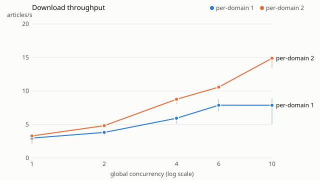
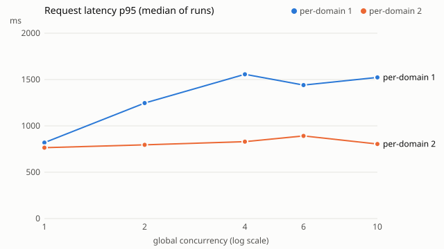

# Download benchmark

Sources: kommersant,ovd-info,sota-vision,sudrf-2zovs,tg-mediazzzona,tg-ovdinfolive. Runs: 30; repetitions per level: 3–3.

| per-domain | global | runs | articles/s median (min–max) | p95 ms | failed | 429 | 403 | retries | note |
|---:|---:|---:|---|---:|---:|---:|---:|---:|---|
| 1 | 1 | 3 | 2.98 (2.56–3.54) | 820 | 0 | 0 | 0 | 0 |  |
| 1 | 2 | 3 | 3.82 (3.38–4.00) | 1246 | 0 | 0 | 0 | 0 |  |
| 1 | 4 | 3 | 5.93 (5.16–6.36) | 1557 | 0 | 0 | 0 | 0 |  |
| 1 | 6 | 3 | 7.88 (7.02–8.74) | 1440 | 0 | 0 | 0 | 0 | above ceiling 5: domain gates bind |
| 1 | 10 | 3 | 7.87 (5.06–8.89) | 1523 | 0 | 0 | 0 | 0 | above ceiling 5: domain gates bind |
| 2 | 1 | 3 | 3.30 (2.04–3.49) | 765 | 0 | 0 | 0 | 0 |  |
| 2 | 2 | 3 | 4.83 (4.57–5.19) | 795 | 0 | 0 | 0 | 0 |  |
| 2 | 4 | 3 | 8.77 (8.01–8.80) | 830 | 0 | 0 | 0 | 0 |  |
| 2 | 6 | 3 | 10.58 (10.51–10.91) | 892 | 0 | 0 | 0 | 0 |  |
| 2 | 10 | 3 | 14.89 (13.39–15.15) | 804 | 0 | 0 | 0 | 0 |  |

## Recommendation

- per-domain 1: global 6 — 7.88 articles/s, the smallest safe level within 95% of the best median.
  Ceiling 5 reached: more domains are needed to measure higher global limits.
- per-domain 2: global 10 — 14.89 articles/s, the smallest safe level within 95% of the best median.
  Ceiling 10 reached: more domains are needed to measure higher global limits.

